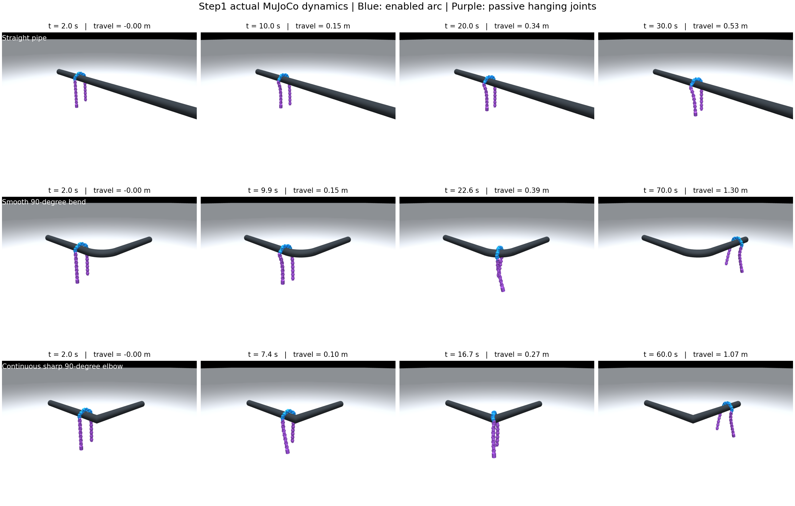

# Snake_ARC

圆弧滚动管外运动研究。当前开发范围为研究路线 Step1：固定局部使能区域的圆弧滚动，其余关节关闭主动驱动，验证水平直管、柔弯及实体连续的 L 型急弯。

参考 `Snake_Robot_Gait` 的目录结构：`codes/` 为入口，`snake_control/` 为共享控制模块，`mujoco_model/` 为模型，`tools/` 为模型构建工具，`validation/` 为验证，`configs/` 为参数，`docs/` 为交接和复用说明。

Step1 的基础控制与三类管道动力学仿真已完成。默认 20 关节，固定使能 J8–J13，其他关节关闭主动驱动并保留机械阻尼。弯管全程使用同一圆弧滚动步态，没有步态转换或根部位姿牵引。自动接触识别、滑动窗口和顺应性属于 Step2。



| 场景 | 仿真时间，含 2 s 静置 | 实际沿管进度增量 | 结果 |
| --- | ---: | ---: | --- |
| 水平直管 | 30 s | 0.526 m | 持续滚动推进 |
| 水平柔弯，90°、中心线半径 300 mm | 70 s | 1.296 m | 整体通过，沿出口继续推进 |
| 实体连续的水平 90° 急弯 | 60 s | 1.070 m | 整体通过，全程保持同一滚动步态 |

结果来自当前参数的一次确定性运行，不代表任意摩擦、姿态和尺寸下的通过率。急弯过程中主动驱动力矩触及 2.355 N·m 上限，仍需关注实际驱动裕量。完整验收、静止/反向对照和阻尼对照见 [实验记录](validation/reports/step1/README.md)。

## 运行

本轮使用本机已有的 Windows Python 3.12.4、MuJoCo 3.3.0 环境。以下命令在仓库根目录执行；换用其他 Python 时将 `py -3.12` 替换为对应解释器。

```powershell
# 新环境安装；本机已有依赖可跳过
py -3.12 -m pip install -r requirements-tested.txt

# 三维交互仿真：空格保持/恢复滚动相位，物理仿真仍继续
py -3.12 codes/Rolling_Arc_Mujoco.py --scene straight --duration 30
py -3.12 codes/Rolling_Arc_Mujoco.py --scene bend90 --start-x -0.35 --duration 70
py -3.12 codes/Rolling_Arc_Mujoco.py --scene elbow90 --start-x -0.25 --duration 60

# 无窗口动力学仿真
py -3.12 codes/Rolling_Arc_Mujoco.py --headless --scene elbow90 --start-x -0.25 --duration 60 --output validation/results/elbow90.json

# 正式实验及结果重现；默认运行三场景、静止、反向和两种低阻尼对照
py -3.12 validation/step1_experiment.py

# 只重跑选定场景，单独输出，避免覆盖完整验收报告
py -3.12 validation/step1_experiment.py --cases elbow90 --output validation/results/elbow90_repeat

# 控制/失能/配置和实机映射的必要检查
py -3.12 -m unittest discover -s validation -p "test_*.py" -v

# 从已保存实际状态渲染截图；不会重新执行试验
py -3.12 validation/render_step1.py

# 本轮不连接硬件；仅预览原设备档案对应的目标与使能报文
py -3.12 codes/Rolling_Arc_Real_Preview.py --phase 0.5 --output validation/results/hardware_preview.json

# 实机单文件入口：真实串口，Ctrl+字母热键/控制台，不使用外部可视化程序
py -3.12 -m pip install -r requirements-real.txt
py -3.12 codes/Rolling_Arc_Real.py --port COM9 --log logs/rolling_arc_real.jsonl

# 同一实机控制流程的离线演练，不连接机器人
py -3.12 codes/Rolling_Arc_Real.py --dry-run
```

默认参数在 [configs/step1.json](configs/step1.json)，关节编号从 1 开始。需要调整方向时将 `direction` 改为 `-1`；默认幅值 60°，角频率 0.6 rad/s，初始相位 0。当前自动搭管初始化按相位 0 的圆弧构型设计；更改初始相位或窗口/幅值组合后需要重新检查初始构型与碰撞，不能直接沿用本次验收结论。

场景由参考模型派生，已随仓库保存；复建命令为 `py -3.12 tools/build_step1_scenes.py`。XML 单独载入不会自动搭管，应通过步态入口设置初始姿态并驱动电机。

## 文件位置

| 文件/目录 | 用途 |
| --- | --- |
| `codes/Rolling_Arc_Mujoco.py` | 可视化及无窗口仿真入口 |
| `snake_control/rolling_arc.py` | 共享圆弧目标、固定使能窗口、限矩驱动 |
| `snake_control/simulation.py` | 初始搭管、物理步进与实际状态测量 |
| `mujoco_model/` | 复用的 20 关节机器人、网格和三种管道 |
| `tools/build_step1_scenes.py` | 保留原碰撞几何，生成水平管场景 |
| `validation/step1_experiment.py` | 动力学验收、对照和实际状态存档 |
| `validation/reports/step1/` | 已提交的结果、原始状态、截图和指标图 |
| `codes/Rolling_Arc_Real_Preview.py` | 原设备档案对应的离线报文预览 |
| `codes/Rolling_Arc_Real.py` | 独立实机串口入口，参数/公式集中，Ctrl 热键和控制台调试 |
| `docs/实机调试代码说明.md` | 真实运行、调试键位、常改位置、反馈与验证边界 |
| `docs/Step1设计说明.md` | 步态公式、失能含义、初始化及验证边界 |
| `docs/复用来源.md` | 源仓库文件与修改说明 |
| `交接记录.md` | 当前完成内容、命令、未完成部分和后续接口 |

本机实际状态回放视频位于 `validation/results/videos/`，Git 保存对应的完整状态文件和生成脚本，视频本身不入库。生成视频需安装 `requirements-media.txt`，执行 `py -3.12 validation/render_step1.py --video`，默认四倍速回放。

实机代码已补齐：一份 Python 文件直接连接真实舵机，按 Ctrl+U 形成局部圆弧，Ctrl+J/H 正反单步，Ctrl+G 连续/暂停，Ctrl+X 全部失能；不使用 F 键。代码顶部可直接改参数，`joint_angles_deg()` 可直接改公式，运行中也可输入 `amplitude=58 omega=0.5 delta=0.05`。详见 [实机调试说明](docs/实机调试代码说明.md)。

三类管道已完成的是动力学仿真验证。实机程序完成了离线串口检查和 Windows 热键监听启动/退出检查，真实机器人通过实验尚未执行。运行实机入口时，由该脚本直接占用串口，原 EXE 等其他串口程序应关闭。
