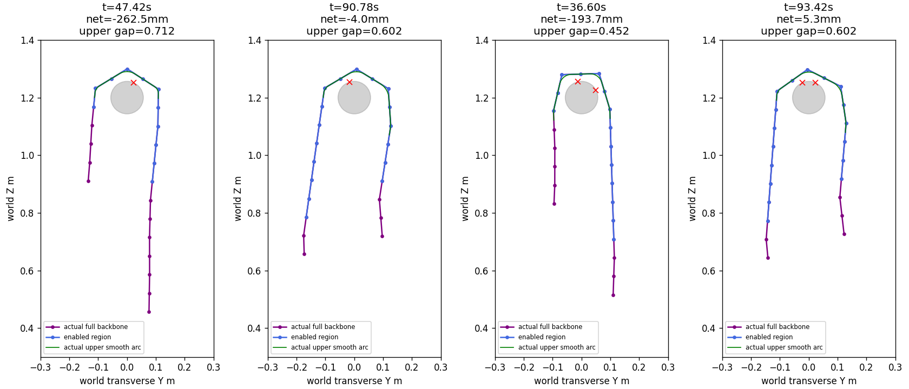
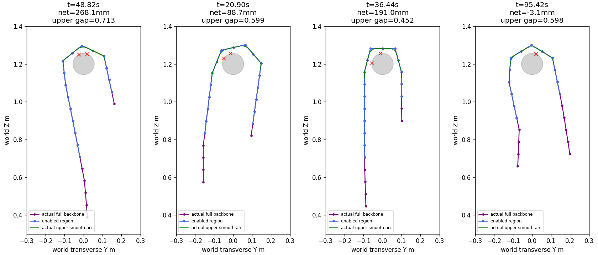

# 主动连续送链：大幅双向往返已实现

更新：2026-10-14用户随后授权实机验收，最终数学核心已同步至现有实机单文件及Ctrl热键手调入口，见[同步报告](../active_feeding_port/README.md)和[操作说明](../../../docs/主动送链实机验收说明.md)。本页以下是同步前的动力学研究记录；“不改实机”描述当时范围，研究数据与验收边界保持原样。

2026-10-14继续开发后，在113mm水平直管、原物理参数下，实现了停止普通滚动相位时主动调长两侧：±258mm完整往返通过，−64.5mm小幅通过。控制只输入全关节角和时间；没有外拉、根部约束或运行中位置重置。沿管骨架平均最大变化分别4.31/4.83/.19mm，说明本次调整不依赖沿管推进；仍有厘米级横摆，不能称三维位置完全固定。

这达到本轮限定的研究目标，不等于已实现任意管径、任意长度比例或实机通过。大幅交接最多16关节使能，其中许多用于展直与承托交接；不是始终只有6个弯曲关节使能。其余关节主动驱动力矩始终0。

已停止新增动力学，完成本地归档与commit；不上传GitHub、不改实机和Ctrl手调入口、不连接硬件。项目首页保持项目介绍及启动用途。

## 最终三例及验收

真实长度以实际全身骨架在管轴高度z=1.2m两侧穿越点切取，属于统一评价定义，**不是精确接触脱离点**。正目标表示头侧增长、尾侧缩短；净材料转移为两侧变化差的一半。去程取2s目标观察末态，返回残差相对6s起态。过程中的运动误差不要求从出发瞬间就≤12mm；验收要求目标观察整个2s及返回观察整个2s两侧分别≤12mm，完成帧也符合。

| 请求净材料转移 | 实际去程头/尾变化 | 实际去程净转移 | 返回头/尾残差 | 总时间 | 结论 |
| --- | ---: | ---: | ---: | ---: | --- |
| −258mm | −261.47 / +263.45mm | −262.46mm | +6.17 / −4.40mm | 93.42s | 通过 |
| +258mm | +269.98 / −266.17mm | +268.07mm | −4.35 / +1.94mm | 95.42s | 通过 |
| −64.5mm | −60.88 / +67.85mm | −64.37mm | −.62 / +1.21mm | 40.04s | 通过；最终算法同输入等价回放 |

大幅去程2s各侧最大绝对误差：负方向5.46mm，正方向11.9963mm；正方向接近12mm边界，**裕度有限，不报鲁棒保证**。返回2s负方向各侧最大6.11mm、正方向7.26mm；完成帧见表。小幅去程最大5.46mm，返回最大2.73mm。

小幅原动力学在第七轮完成；最终算法在其完整材料位置范围|p|<1.5内与当时零中央协调恒等，归一化速度也不变。按当前默认分配参数重放全部2002帧，目标最大误差2.0e−13°、掩码0不一致，故没有新增一次相同动力学来凑回归数。最终两个大幅各1次新动力学，4671/4771帧完整回放也一致；[软件回放](round_09/offline_checks.json)共11444帧。软件回放只证明控制计算一致，物理结论来自对应原始动力学轨迹。

## 全过程形态、承托和运动审查

| 实际指标，6s以后所有50Hz保存态 | −258mm | +258mm | −64.5mm |
| --- | ---: | ---: | ---: |
| 最高连续弯曲段实际平滑总转角 | 174.79–180.95° | 173.98–180.89° | 175.41–180.95° |
| 该弯曲段最小平滑开口/曲线长度 | .45158 | .45160 | .58534 |
| 全身所有同向转角最大合计 | 190.47° | 188.53° | 186.73° |
| 全身反向弯曲最大合计 | 17.38° | 24.73° | 6.55° |
| 向上接触支撑合力 | 27.56–28.49N | 26.71–29.15N | 27.68–28.32N |
| 骨架平均沿管最大变化 | 4.31mm | 4.83mm | .19mm |
| 骨架平均三维最大变化 | 44.97mm | 63.93mm | 24.01mm |
| 支撑力加权接触点三维最大变化 | 32.04mm | 44.60mm | 21.62mm |
| 最高带三维最大变化 | 56.86mm | 56.26mm | 33.11mm |
| 局部平面拟合RMS最大 | .0262mm | .0316mm | .0053mm |
| 保存态平滑曲率最大 | 24.13/m | 24.14/m | 18.84/m |
| 最大/完成时使能数量 | 16 / 16 | 16 / 12 | 15 / 13 |
| 掩码交接次数 | 11 | 13 | 5 |
| 饱和关节×1ms步数 | 38 | 29 | 15 |
| 失能主动矩最大 / 限位超量 / 落地步数 | 0 / 0 / 0 | 0 / 0 / 0 | 0 / 0 / 0 |
| 共有使能目标单次20ms最大变化 | .9° | .9° | .9° |
| 长度观察无效保存态数 | 0 | 0 | 0 |

形态、长度、空间、支撑覆盖所有50Hz实际保存态；力矩/限位/落地统计覆盖每1ms物理步。没有声称支撑逐1ms真值或逐帧人工观看视频。完整时间曲线、去程/返回/交接分镜、最差全身转角和最小上弧开口均审查。此场景没有障碍，越障后持续运动不适用；普通滚动指令phase全程0，但材料弯曲分布持续移动，真实机器人没有被固定在世界坐标。

“骨架平均”不是质量加权质心；支撑点的变化也包含接触力重新分配。失能0主动矩仍保留机械阻尼1.5，尚未辨识真实断电舵机动力学。没有能耗/效率对照或电能测量。

### 形态评价范围修正，旧指标全部保留

使能掩码含长的展直与交接直线缓冲，直接把其全部长度算作半圆会使开口指标失真。按>5°全身弯曲首末关节划一个大区间，还会夹进不连续远端小弯折。第三轮之后、后续回归之前，已在[第三轮计划](round_03/plan.md)明确只读评价最高点附近的连续实际弯曲组：弯曲关节间距≤2，允许交错轴中间一个近直关节，边界取半连杆，使用实际平滑曲线；150–218°和开口≥.4的数值不变。同时全身所有同向转角仍≤218°，避免裁剪隐藏第二圈；全身反向弯曲、全骨架图和视频继续审查。

原`acceptance`字段依然保留false，包含旧使能区开口及管心极角条件；当前研究目标逐项在`research_goal_acceptance`中记录，三例均true。旧极角最大305.40/283.19/286.60°，长悬垂腿的端点位于管心下方，整条开放U形也会有较大的管心极角，不能单凭它判定螺旋。实际最高弧约180°、全身同向不足191°、真实骨架与最小开口图共同支持本次开放形态。最早失败例的全身同向249–283°、支撑中断等没有因此变成通过。





## 实现与输入边界

- [控制器](../../../snake_control/continuous_feeding.py)：连续材料位置p跨同轴关节组接续，奇数轴总目标角180°、偶数轴0。左右曲率周期分配`b=−.12*sin(pi*p)`；额外中央分配随|p|连续启用，小范围为0、大范围最高15°，两端减多少中央就加多少，不提高总角。它是当前位置范围的工程增益分配，不是由管径推导的普适律，不含截面顺应/Yamada积分或名义恢复项。
- [全骨架长度观察](../../../snake_control/whole_feeding_observer.py)：全关节角重建，合格失能末端最末3连杆给出条件性向下方向；两端一致时融合，否则用可用的较长端。第一次合格起态标定虚拟切片深度，后续在全局最高带下方同深度切取材料长度。切片不随掩码端点高度变化，不测真实管轴或接触脱离。
- 使能覆盖规划弧、估计的实际上弧、后侧两关节缓冲及附近≥5°折弯。折弯展直后，profile离开至少1关节材料距离才允许退出，避免重力下重新弯折造成反复接管。大幅时控制区域扩大，包含直线展直段；未做到只使能真正弯曲的半圆。
- 出区须角度≤8°、骨架低于起态弧深度加半连杆余量、朝自由端连杆与条件向下方向点积≥.97，并持续.4s新反馈。它是几何释放代理，**不是实测卸载**。
- 保留去程增长的一端作为贯穿往返的失能参考，正方向使能下界J4、负方向上界J17，至少保留观察器需要的3个末端失能连杆；附近残留折弯仍计入全身审查。
- 最大角度跟踪差>5°或使能区实际绝对角合计>192°时，暂不推进p、继续完成当前形状；10s仍未恢复则记录失败。最大送链速度.1关节/s。接近目标允许反向纠偏，长度代理误差≤4mm、代理速度≤1mm/s×max(1,请求量/连杆长度)持续.4s后进入2s观察，观察期间继续反馈。

控制器只接收角度、反馈时间和控制时间；静态输入是机械长度、初始窗口和用户请求量。世界骨架、管径、真实重力、接触合力、根部位姿和力矩均在评价侧。最后三例所有输入字典严格只有电机角/采样时间，外加力0、根部自由、状态有限。仅角度可移植是软件输入边界，不是已完成真实机器人验证。

实际场景核对：管道中心线x=−1.2…1.8m、y=0、z=1.2m、半径.0565m，20关节/21根64.5mm连杆，初态J8–J13、60°、phase0、x=−.5m，建立6s。摩擦[2,.005,.002]、重力[0,0,−9.81]、Kp127/Kd1、限矩2.355Nm、机械阻尼1.5及armature .01不变。沿用既有Conda `mujoco`，未安装依赖；物理1ms/控制20ms/读角200ms。

## 每轮发现、改进与保留的失败

本次续开发共9个小轮、18次动力学，每轮1–3次，失败先复现/定位再进入相关回归，没有参数网格、长hold、反馈延迟、低阻尼或额外场景矩阵。此前[连续送链旧批次](../continuous_feeding/README.md)的4例是另一批已结束实验，原失败不改写。计划和全部数值见[开始前总计划](../../../docs/主动送链持续改进计划.md)及[所有轮次汇总](round_summaries.json)。

| 轮次/实际数量 | 已确认问题或结果 | 原因判断、修复及下一最小验证 |
| --- | --- | --- |
| 第1轮/2 | 几何缓冲仍返回失败；全局观察修复完成软件返回但净残差−24.22mm、形态/支撑失败 | 局部窗口切片随掩码变化，不能代表真正上弧；改全骨架观察。后续检查实测角度跟踪，而非只看completed |
| [第2轮](round_02/plan.md)/1 | 末态头−61.52/尾−34.61mm，共同缩短，净差掩盖问题；全身同向249°、有向上支撑0 | 目标平移过快、旧失能边界重新弯折，高置信；补附近展直、对齐释放、慢速交接及双侧验收 |
| [第3轮](round_03/plan.md)/2 | 大幅双侧往返已达标，正向有59保存态开口<.4，最低.39284 | J19约5–6°残留与主弧连接；12°才接管过迟。先把接管降到5°再复现，不忽略极小超量 |
| [第4轮](round_04/plan.md)/2 | 首例形态通过却124次交接、去程超时；[滞回修复](round_04/repair_plan.md)去程完成，返回J3–19两端过短、观察失效 | 展直后立即释放导致折弯复发，高置信；保留材料距离有效，但须同时保留失能参考端 |
| [第5轮](round_05/plan.md)/3 | 保护参考端后大幅双向通过；小幅去程双侧最大14.70mm | 统一15°中央集中对半单元位置造成共同长度偏移，中等置信；先小幅定向减弱，不重跑已知无关场景 |
| [第6轮](round_06/plan.md)/2 | 10°例末态双侧合格但早期未到位；[1mm/s修复](round_06/repair_plan.md)仍去程尾误差13.39mm | 提高速度判据严度不能替代形状改进；停止延长静置，取消额外中央集中试验 |
| [第7轮](round_07/plan.md)/2 | 零集中量小幅通过；大幅正向去程误差12–15mm | 单一常数不能兼顾幅度范围；采用连续材料位置分配，小幅已有记录可等价回放 |
| [第8轮](round_08/plan.md)/2 | 连续分配正向通过，负向去程双侧约13–19mm偏差 | 大幅统一等待1mm/s期间仍真实漂移；代理不是真值。按请求量归一化速度，复现负向失败 |
| [第9轮](round_09/plan.md)/2 | 大幅双向及小幅等价记录全部通过 | 当前限定研究目标满足；停止动力学，保留有限精度/控制数量等边界，交由用户验收 |

以上各叶目录保存`status.json`、`actual_trace.jsonl.gz`、`review.json`、`timeline.png`、实际截面/分镜、当时控制器/观察器/入口源码。本机`actual_full.mp4`来自真实保存态回放；按项目规则视频不入Git，轨迹与生成脚本可以重建。九轮中后续没有执行的计划病例是因先修失败而跳过，不伪造补齐数量。

6项针对性软件检查通过：跨单元平面/总角/限角/连续性、长度差与掩码计数区别、时间戳、观察无效时继续完成形状并有限等待、释放的持续低位/对齐、折弯保留不能用尽参考端。旧连续性经验常数未含新增smoothstep导数，曾误报；改为插值/正弦协调/增益渐变的解析导数上界，物理目标45°/s约束及实际.9°单步不变。[测试源码](../../test_continuous_feeding.py)。

## 已实现边界与下一步

已确认：当前默认起态的113mm直管，固定普通滚动相位下，可主动实现约一根及四根连杆材料量的两侧反向调长，并自动返回；实际最高弧开放、保存态持续承托、其余失能主动矩0。每次短目标观察期真实两侧达到本轮精度条件。

仍有问题：长度代理相对真实净差误差RMSE为10.16/5.48/8.54mm，最大20.82/14.56/16.79mm，明显不是精确管轴长度观测。正向大幅去程精度裕度很小；不保证长期hold不漂移。全身仍有最大17–25°反向小弯折；大幅使能扩展至16，负向完成时也保持16，直线缓冲须等下一次材料移动后才可能释放，不称全部恢复到6关节。厘米级横摆仍存在。

合理推测：交接完成前保留旧段、抑制折弯复发、保护角度参考端是返回成功的主要原因；连续曲率分配改善了大小幅之间的折中。因各针对修复并非完整单变量对照矩阵，不宣称某一项独立提升通过率或具有普适稳定性证明。

未验证：真实串口/失能反馈/真实机械阻尼、任意起态标定、110→210等其它管径、弯管、滚动同时主动送链、超过四连杆的可达范围及长时间保持。可连续请求分数材料量是接口能力，不等于已证实任意左右比例。

下一项最小工作是用户查看最终两个大幅实际视频并验收研究原型；获得后续同步指令再移植现有实机/手调入口、由用户实测。当前不新增实验或硬件动作。

## 查看及按需复现

最终实际视频：[负向往返](round_09/head_large_20261014_141738/actual_full.mp4)、[正向往返](round_09/tail_large_20261014_142024/actual_full.mp4)、[小幅](round_07/small_20261014_140308/actual_full.mp4)。

在已激活`mujoco`环境的仓库根目录，仅按需要单例复现，另存目录：

```powershell
python -X utf8 validation/continuous_feeding_experiment.py head_large --report-root validation/results/my_active_feeding --round-limit 1
python -X utf8 validation/review_continuous_feeding.py --report-root validation/results/my_active_feeding --render
```

`head_large/tail_large/small`由请求量选择，不是手动移窗。只读软件检查无需物理运行：

```powershell
python -X utf8 validation/test_continuous_feeding.py
python -X utf8 validation/continuous_feeding_offline_check.py
```
