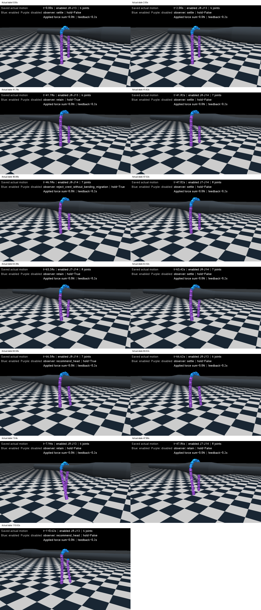
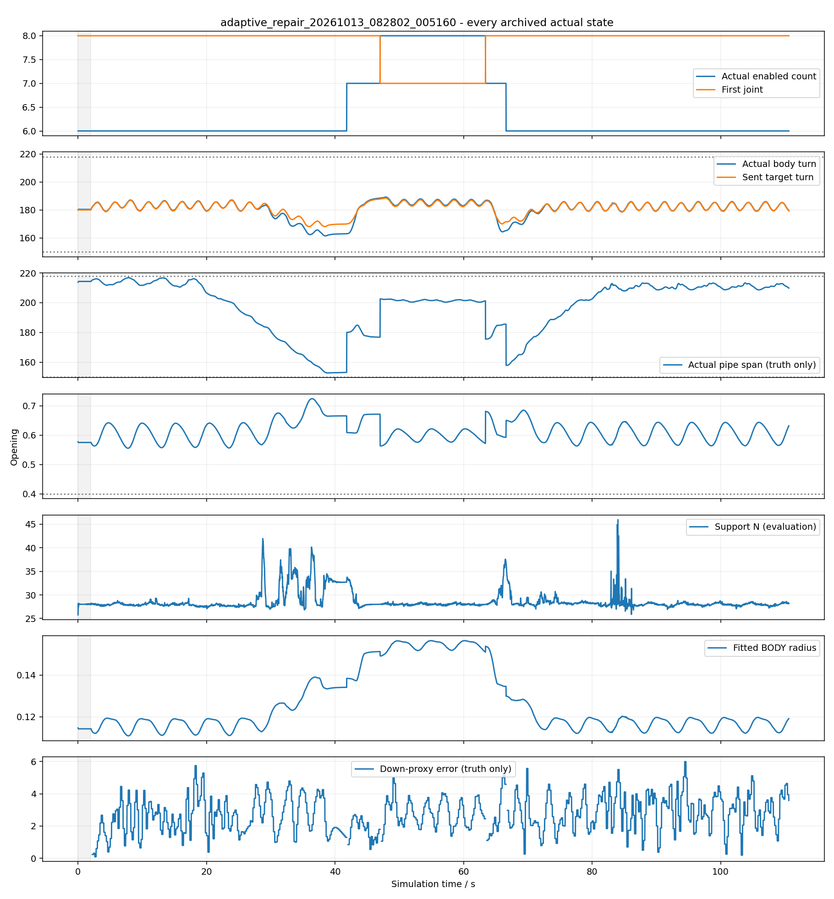

# 自动6↔8使能长度与滑窗：2026-10-13复盘

**原型已实现，自动6→7→8→7→6及与三次位置滑窗的组合已在实际动力学中观测到；身体形态、支撑和失能检查通过。全部严格验收尚未完成，不更新实机及现有手调默认入口。**

原被动身体半径方案不能自动收缩，留下235.7°管轴跨度失败；修复改为只用角反馈的受约束长度可行性试探。严格出口计时和急弯管轴评价又发现问题，最终结果必须按下面的更正判读，不能沿用初次审查的“完整通过”。

## 方法和条件

冻结的[计划](../../../docs/自适应使能长度实验计划.md)为4个病例加最多1次针对性修复；实际正好5次，没有扫描延迟、被动阻尼、强度或重复挑选成功。修复假设先写入[repair_plan.md](repair_plan.md)。

沿用已有Conda `mujoco`：Python3.9.21、MuJoCo3.2.7、NumPy1.23.5，没有安装新环境。20关节、21段64.5mm，半圆参考每奇偶族π，频率.6rad/s；K=.02、yielding=.7、目标过滤.15s；PD127/1、限矩2.355Nm，被动阻尼1.5/armature .01。

全20角新反馈200ms、目标20ms、物理1ms。控制器只读实际角、时间、已发相位和已知掩码/尺寸；世界姿态、管径、接触和实际矩只用于评价，没有回灌。失能主动矩0并不等于机械阻力0，也不证明实机等效。

场景读取真实XML几何：新直管名义直径110→210→110mm，渐扩x=-.2.. .15m、210mm段.15.. .55m、渐缩.55.. .9m，长出口至3.5m；48边形实体圆环生成连续凸体，中心z=1.2m、管轴X。八关节校准为210mm恒径。复用的连续90°急弯，转角确为90°，变径跨拐角前后总.3m、110→210mm，实体连续，无截断口。初态为已搭好的名义圆弧，静置2s，不是任意姿态自主搭管。

## 五次记录与最终判定

| 实际记录 | 时间 | 观测到的行为 | 最终验收范围 |
| --- | ---: | --- | --- |
| [八关节恒径](calibration_20261013_081414_692753/review.json) | 35.00s | 固定J7–J14，第一周期24格校准 | 下一周期52个新反馈零误报，82.69%有效；形态/支撑/失能通过 |
| [固定六关节基线](baseline_20261013_081646_022244/review.json) | 112.08s | 始终J8–J13，完整通过变径段 | 全程身体与管轴范围通过；连续完全出口仅1.656周期，未满2 |
| [被动半径原型](adaptive_20261013_081901_624965/review.json) | 109.76s | 6→7→8，不收缩 | 身体指标合格但实际管轴最大235.716°，失败保留 |
| [可行性修复](adaptive_repair_20261013_082802_005160/review.json) | 110.62s | 自动6→7→8→7→6 | 全程形态/管轴/支撑/失能通过；最后扩缩后4.202周期，连续完全出口1.801周期，严格时长未验满 |
| [合并连续急弯](combined_20261013_083240_926004/review.json) | 150.00s | 一次扩/缩、三次六关节相邻移窗 | 身体/力学合格；单管轴有不可测阶段，最后移窗后1.641周期，未达到完整验收 |

每例保存全部20ms实际qpos/qvel、目标、使能、反馈、相位、状态/事件、接触及矩；1ms统计保存在status。评审检查全部25878保存态，控制输入重放25873帧，目标/相位最大差0、掩码0差异、交接事件一致，见[input_replay.json](input_replay.json)。9项针对性软件检查通过，没有物理或设备操作；包括七关节交易、两次新反馈、奇偶π预算和连续出口计时回归。

## 直管主成果及失败原因

修复例37.4s根据六关节被撑开的实际形状申请8，41.8s加入J14成7，47.0s再加入J7成8；57.6s经过八关节完整周期后申请可行性收缩，63.4s释放J7成7，66.6s释放J14回6。77.2s又一周期52次新反馈确认6的实际形态可行。没有脚本指定移窗、没有按场景位置/管径标签指定长度，也没有重设位姿。

| 全程指标 | 固定6基线 | 原半径方案 | 可行性修复 |
| --- | ---: | ---: | ---: |
| 身体转角 | 160.10–187.13° | 161.44–189.21° | 161.44–189.21° |
| 实际管轴跨度 | 151.49–216.82° | 152.76–235.72° | 152.76–216.82° |
| 最低开口比 | .55547 | .55547 | .55547 |
| 最大平面RMS | 8.525mm | 8.525mm | 8.525mm |
| 最低全身向上支撑 | 16.507N | 26.844N | 25.869N |
| 失能主动矩最大 | 0 | 0 | 0 |
| 地面接触/越限/非有限 | 均0 | 均0 | 均0 |
| 饱和关节×1ms步 | 42484 | 18705 | 23915 |

饱和计数不是整机饱和毫秒，也不是电能。固定6已能通过该变径段的运动和形态，因此没有通过率提升或“粗管必须8”的证据；不同暂停/相位历程也不支持直接从饱和总数断言效率优势。修复方案是在6/8允许集合中选择已观测可行长度，可能在粗管上保留约160°的6关节身体圆弧，不是管径识别或全局最优关节数。

**原型失败已确认：**身体半径由主动参考及重力/接触共同决定，八关节在细管上仍保持自己的较大半径，原“半径变小才回缩”信号没有出现。保持身体开放并不保证管轴角跨度合格；原235.7°失败不能从漂亮的身体半圆截图中抹去。可行性试探避免该例一直保持8，但没有证明能应对所有变化或更小管径。

最低支持覆盖（当前窗口含边界的分箱/全身支持）分别0、.4186、.3289：全身支撑并非始终全部来自使能段。控制器没有接触观测，不能将“有支撑”写成已识别承重区域，也不能从实测角直接证明卸载。

## 合并急弯：机制成立，完整范围未验收

24.8s J8–J13→J7–J12；73.2/79.6s扩为J6–J13；96.0/99.2s回到J7–J12；110.8s→J6–J11，132.8s→J5–J10。所有交易串行；7关节仅在明确扩缩期间，全部记录没有孤立稳定7状态。身体159.82–188.75°、最低开口.54749、最大RMS8.525mm、最低支撑23.938N；失能主动力矩0，无落地、越限和非有限。饱和140836关节步、峰值2.355Nm，不能宣称没有饱和。

三次位置交接的[独立真值](combined_20261013_083240_926004/handover_truth.json)：真重力冠部残差分别−.537、−.692、−.788关节，与头向建议一致；向下估计误差.095°/.971°/1.631°；新窗口支持覆盖1.0/.8470/.9100；交接前退出主动矩约−.0279/−.0151/−.0251Nm。上述值没有送入控制器，也不是实机反馈。证据支持本例三次滑窗判断，但不能保证所有时刻都可观测。

35.02–55.02s的一次扩张拒绝：J13仍约8.319°，速度约−.026°/s，候选形态与当前观测合格但不满足4°小角门槛。暂停相位不一定让尚失能的进入关节变直；主动矩0仍有接触和机械阻力。拒绝保持原六关节，没有放宽门槛取得通过；后续滚动使实际角改变，才成功交接。原因判断为高置信，但尚未分离接触与机械阻力贡献。

**急弯评价必须更正：**旧最近中心线法报1744帧两轴不可测，另报27帧“可测但覆盖<150°”。逐状态核对发现后27帧全是最近骨架投影选入弯X轴、实际弧段/边界接触出弯Y轴，轴不一致，不能据此证明物理覆盖不足。[corner_axis_diagnosis.json](combined_20261013_083240_926004/corner_axis_diagnosis.json)保留旧132.47°数值、两种轴及完整27帧。

评价层现加入实际接触轴与最近点轴一致性检查，未改控制器。修正后2923个滚动保存态不可可靠测量（其中1179轴冲突），其余可定义单轴的跨度152.86–216.12°、没有边界违规。不可测区没有改判通过；需要进一步定义跨两段急弯时的截面/覆盖，不能用身体平面性代替单管轴验收，也不能用无法代表场景的投影数字否定实际运动。

## 出口计时缺陷与更正

第一次审核误将“第一次全身越过出口”后的所有相位算成持续出口周期。实际后面有短暂回到边界内，且合并例最后还移窗。因此最初的基线/修复“完整通过”撤回，原始status保留当时计时，review使用全数据重新计算的最后连续出口后缀。

基线连续完全出口1.656周期、修复1.801；修复最后一次扩缩后已4.202周期，形态一直合格，但不能将它替代严格连续出口2周期。合并连续出口5.462周期，最后一次移窗后只有1.641周期。驱动和验收代码已改为重新入界就重置出口计时、按真实推进指令相位检查末次交接后2周期；软件回归通过，没有新增动力学验证修正后的停止条件。

合并例是在该计时问题发现前依据当时初审通过执行，最终统一更正所有判定，保留原实际记录。这些时长不足不抹去已观测的扩缩/滑窗和全过程形态成果，但意味着本轮未完整满足冻结计划，不能写成全部通过。

## 交付、未验证与下一最小工作

代码位置见[设计与修改说明](../../../docs/自适应使能长度设计.md)。当前默认可行性版本；原半径方案显式保留用于失败对照。原实机文件和现有手调默认三模式均未修改；本轮没有真实机器人、真实串口、热键或能耗实验。

未验证：修正停止条件后的完整出口验收、急弯单轴不可定义阶段、进入关节接入规则的改进、4/10等其他长度、其他速度/反向、真实采样与机械参数。当前5次预算全部使用，不追加第6次或参数搜索。

下一最小工作先用现有记录明确跨弯评价轴，再新一轮只用1个相同直管修复病例补连续出口2周期。控制层针对“进入失能关节”研究实测角预置与候选形态，区分它与退出承重关节的卸载要求，或在无变化的保持中恢复滚动再找相位；不要机械地把所有4°门槛调大。拒绝后的持续证据重置也应明确。全部属于拟议工作，不声称本轮已通过。

实际回放视频位于本机`validation/results/adaptive_arc_length/`，每例以对应目录名命名MP4；10fps完整覆盖0到终态，回放只调用mj_forward，没有重跑动力学。每例同时保存全过程图、交易前后、最差及终态三维画面。视频不入Git，状态、参数、失败、图片和回放脚本入Git；只本地commit，不上传GitHub。
