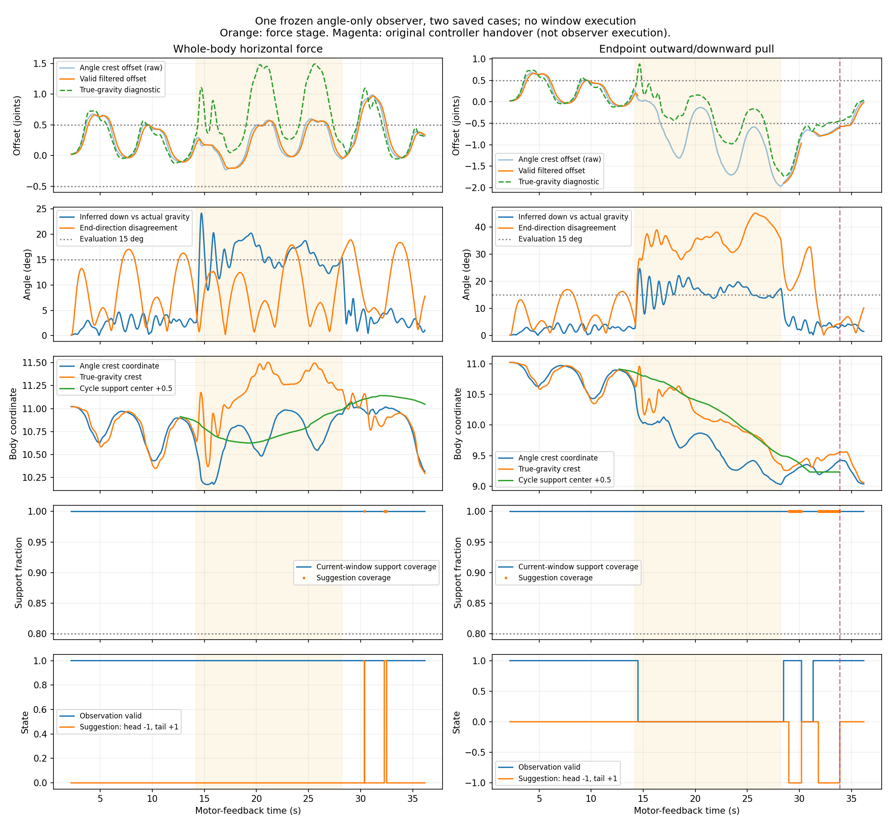
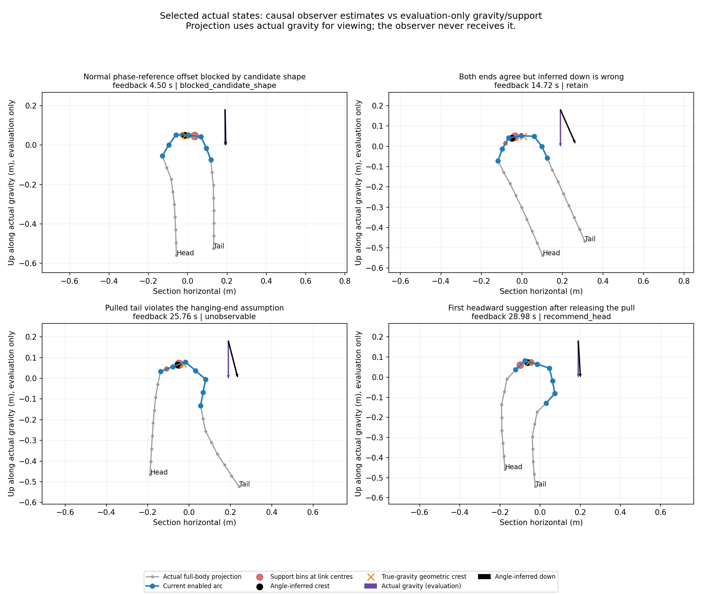

# 角度观察器离线验证与复盘

结论：**实际角度可重建并定位开放圆弧，松开端点拉动后能识别头向迁移；首版不足以在持续拉动中可靠定位，也不能证明建议窗口比当前窗口更必要。因此保留为只输出判断的离线组件，不接闭环、不移植实机。** 这不是对所有角度定位方法的否定，也不是新步态或实机通过结论。

## 计划、输入与实际执行

运行前的假设、条件、白名单和门槛在[冻结计划](../../../docs/角度观察器离线验证计划.md)。观察器为`snake_control/angle_shape_observer.py`，只输入20个实测角、已知滚动相位、当前使能掩码、反馈时刻，机械长度与60°名义幅值为固定配置。无执行器接口，不生成控制目标，不调用移窗；接触、自由根部姿态、真实重力、力矩、管径和原交接事件只进入事后评价。

已有整机横向力、尾端向外/向下拉动两份记录各1700帧，共3400帧，均为113 mm直管，20关节，初始J8–J13。原始档案未修改。沿用已有Conda `mujoco`，本次Python3.9.21、MuJoCo3.2.7、NumPy1.23.5，没有安装依赖或新增动力学运行。

实际完成1轮验证，包含2次完整离线分析：第一次发现数值错误后留档，修复后重放同两份记录；另外有1次首帧输入格式错误中断。没有参数搜索或新增场景。3项针对性软件检查通过，覆盖持续建议不执行、不可靠/重复反馈不确认、几何分段不变性。

观察角来自`measured_controller_deg`的J1–J20字典，按编号显式解码；它们是原控制器读到的真实模型角，不是位置目标。已知相位使用反馈时刻之前的已下发相位，首帧为已知启动相位0。原反馈在控制状态保存之前20 ms采集，评价匹配同一反馈时刻的上一实际状态；每份首帧没有匹配状态，标为评价缺失，其余1699帧均匹配。最大角度匹配差约1.11×10⁻¹⁶ rad，重建骨架与原真实骨架最大差约2.27×10⁻¹⁵ m；这是角度、尺寸、坐标符号和时刻核对，不证明方向估计或支撑定位正确。

两份600帧的无扰动前缀完全相同，是共同12 s正常滚动片段的重复回放，不能当作两组独立正常试验。名义相位参考来自公式，没有用这两份轨迹训练。

## 已确认结果

以下数字均来自弧长积分修复后的输出，首版错误结果另存，不混用。

| 检查项 | 实际结果 | 判定 |
| --- | --- | --- |
| 无扰动正常滚动 | 600/600帧具备几何判断条件，最终建议0帧；顶部定位误差90分位0.101关节、方向误差最大4.63° | 本片段最终不误建议通过，但内部相位偏移仍有问题 |
| 整机受力14 s | 几何门槛合格700/700帧，建议0；真实方向误差最大24.14°，顶部定位误差90分位0.892关节 | 方向与定位可信度未通过 |
| 尾端拉动14 s | 仅15/700帧具备判断条件（2.14%），685帧两端方向不一致，建议0 | 持续拉动有效覆盖未达到≥50%，未通过 |
| 尾端松开后 | 330/400帧具备判断条件；28.98 s首次建议J7–J12，早于原控制器33.88 s掩码交接 | 识别了部分实际迁移；不能当成执行成功 |
| 建议与支撑相符 | 端点恢复阶段164帧建议的支撑覆盖均1.00；原J8–J13也始终1.00 | 区域相容，未证明移窗必要或有覆盖收益 |

“具备判断条件”只是本方法的内部几何门槛，不是概率置信度。整机受力时有396/700帧内部门槛合格、真实方向误差却超过15°，正说明不能用两端一致性作为真实方向可靠的证明。

端点恢复后的建议分成两个区间：

- 28.98–30.18 s，61帧建议J7–J12。原控制器27.46 s已记录准备请求，但代码核对表明准备期间仍按原窗口连续滚动，未改变掩码；30.96 s才保持相位。因此第一段提供“松手后、原相位保持前已看到头向迁移”的有限证据。
- 31.82–33.86 s，103帧再次建议J7–J12，处于原控制器相位保持期间。它反映该已被原控制器改变运动过程的身体状态，不能当成新观察器闭环运动的独立证据。
- 33.88 s原控制器更改掩码后116帧单独审查，未给进一步建议。观察器收到的是档案中外部更新的掩码，不是自行执行；不能以这段窗口已经变成J7–J12证明观察器移窗成功。

首次建议时刻28.98 s，真实重力参照与角度估计的几何冠部相近，方向误差3.46°，实际原窗口与建议窗口的支撑覆盖都为1.00。松手约0.78 s后才给出建议，故不能宣称已实现“持续滑动时即时跟随”。



橙色为施力时段；紫色虚线为原控制器掩码交接。输入、判断和评价覆盖全保存过程，包括无扰动、完整施力、松手恢复和原控制器交接后的状态。承重周期中心仅用于评价，未进入观察器；其+0.5换算是因为接触桶j对应关节j下游连杆中心的身体坐标j+0.5。不能直接把桶编号与关节锚点坐标相减。

## 主动发现的问题与原因判断

**1. 正常滚动的相位参考仍不充分。** 无最终建议，但116帧过滤偏移超过0.5关节，其中81帧被候选开放形态挡住、35帧处于确认阶段。正常最大过滤偏移0.663关节。4.50 s代表状态中，方向估计误差较小，实际与真重力冠部也接近，名义参考位置却明显偏离。已确认的是理想相位参考和实际正常滚动不一致；不能靠候选形态拒绝来称定位信号干净。具体是参考生成、正常顺应变形和离散滚动共同作用中的哪一项占主导，尚未分解，原因置信度中等。

**2. 两端一致不等于自然悬垂。** 整机受力时，两侧都受到横向作用并一起偏斜。14.72 s两端夹角仅4.16°，却使估计向下方向偏离真实重力24.14°；几何顶部因此定位错误。整个施力阶段372帧两端各自都偏离真实重力超过15°。这是实际数据支持的共同偏差，置信度高；放宽25°一致性门槛不能解决。

**3. 尾端拉动破坏平均估计。** 尾端施力阶段头端方向误差中位5.68°、最大12.23°，尾端中位34.42°、最大39.44°；因此原“两端平均”把较好方向与较差方向混在一起，又因不一致拒绝大多数样本。存在一侧仍提供有用方向信息的证据，置信度高；但不能偷用“本次拉的是尾端”标签来固定选择头端，更不能据这一病例保证单端选择在所有情况下可靠。

**4. 顶部位置与承重迁移不是同一个量。** 端点病例的真重力几何参照出现头向偏移，与周期支撑向头部移动的方向相符，支持这个几何思路有局部价值。整机受力时，真重力几何顶部也出现明显尾向偏移，而周期承重中心最多只偏离原中点约0.375关节；因此加入真实重力也不能自动解决“顶部移动就该移窗”的判断。真实重力参照是原因诊断，不是新方法通过证据。

**5. 支撑覆盖不能区分优选窗口。** 整机病例所有1699个匹配状态中，当前及两个邻居均覆盖全部支撑。端点施力时415/700帧三个窗口都覆盖全部支撑；即使有区别，当前窗口一直覆盖1.00，优选窗口相对当前的覆盖增益始终0。因而建议覆盖达标只表示兼容，不能证明需要迁移、受力更合理或效率更高。

**6. 恢复阶段还有未能判定必要性的建议。** 数值修复后，整机松手恢复阶段输出12帧尾向J9–J14建议：30.36 s单帧、32.28–32.48 s连续11帧。它们不是执行事件，当前和建议的支撑覆盖相同。现有数据不足以把这些建议确定为正确或错误；它们说明不能只报告施力阶段0建议而忽略恢复全过程。



图是实测角重建的实际身体投影，用评价真重力摆正画面；这一显示方向没有输入观察器。灰色为身体，蓝色为当前使能段，红点在承重桶对应连杆中心，大小代表桶内力，**不是原始接触点位置**。黑色为角度估计、橙色为真重力几何参照。图例位于身体之外，未遮住悬垂端。

## 实现错误及保留证据

首帧回放曾按数组读取字典，未产生观察器输出，已显式按J1–J20编号解码；见`adapter_error.json`。

第一次完整分析后，分段不变性检查复现数值错误：同一64.5 mm直线，仅分出0.1 mm小片段就使顶部中心从6.96154变为6.73154关节，误差0.22999。原因是短片段与长片段各取同样数量点而没有乘弧长权重。修复为弧长中点积分后，两种分段均满足物理中心7.0、误差在测试1e−8精度内；3项软件检查通过。全部首轮输出、图和原实现保存在`first_pass_piece_weighting/`，见`numerical_repair.json`。阈值未调整；本页数字是最终修复后输出。

## 研究目标与下一步决定

本轮“只输出、完整核对”的工作已完成；**尚未满足可以替换接触定位器、接入闭环滑窗的研究目标。** 未执行任何新掩码更新或实机实验。保留已有固定截面顺应和接触定位器，不将新观察器插入其运行入口。

下一项最小改进应继续使用现有数据，优先处理观测问题：

1. 用无扰动实测建立冻结的相位基准，去除正常周期分量，避免依赖理想半圆参考；不能在拉动时跟着当前形状更新基准，把真实迁移也扣掉。现有正常片段只有共同12 s，若拿一个周期标定，剩余独立时间很短，需诚实报告验证范围。
2. 比较仅角度可得到的两侧弯曲程度、变化与稳定性，判断能否选出较可靠的悬垂端。选择不得使用施力标签或评价重力；共同偏差无法排除时必须拒绝，而不能只放宽方向夹角门槛。
3. 窗口建议应结合两侧被动边界弯曲变化，追踪圆弧沿身体迁移，而不是将顶部偏移当成唯一触发器。先检验这种特征能否区分本次整机侧摆和端点迁移，再决定是否闭环。

以上是下一轮候选改进，未在本轮继续开发/搜索。若仅角度不能提供可靠方向，再考虑IMU；但本轮已经表明单补重力仍不足以确定移窗必要性。仅角度也不能确认真实卸载，交接观测是另一个尚未解决的任务。

原运动的开放、曲率、支撑、失能、限位和饱和审查继承[原完整记录](../debug_modes/README.md)：两病例实际身体转角分别179.93–186.95°、171.68–187.39°，开口≥0.545，6关节使能、失能主动力矩为零，保存态无越限/饱和。本轮没有改变动力学，不能据观察器结果宣称改善了这些指标。没有越障、没有闭环控制，自主推进和越障后稳定验收不适用。所有结论限于已有直管、理想模型角反馈；未验证真实编码器、其他管径/急弯、反向拉动或重复交接。

## 复现与文件

在既有`mujoco`环境、仓库根目录，只有需要重新分析时执行；不打开串口或GUI，不推进动力学：

```powershell
python validation/angle_observer_replay.py
python validation/diagnose_angle_observer.py
python -m unittest validation.test_angle_shape_observer -v
```

- 两份`*_observer_trace.jsonl.gz`：逐帧白名单输入、完整判断、严格分离的评价字段。
- `summary.json`：所有阶段与原掩码交接前后的统计、环境、时刻/正运动学校核。
- `cause_audit.json`：单端误差、覆盖歧义、原准备/相位保持/掩码变化分段、代表与最差状态。
- `observer_full_process.png`、`diagnostic_actual_states.png`：完整时序及实际状态审查。
- 原始记录仍在`../debug_modes/`，未另复制或覆盖。
