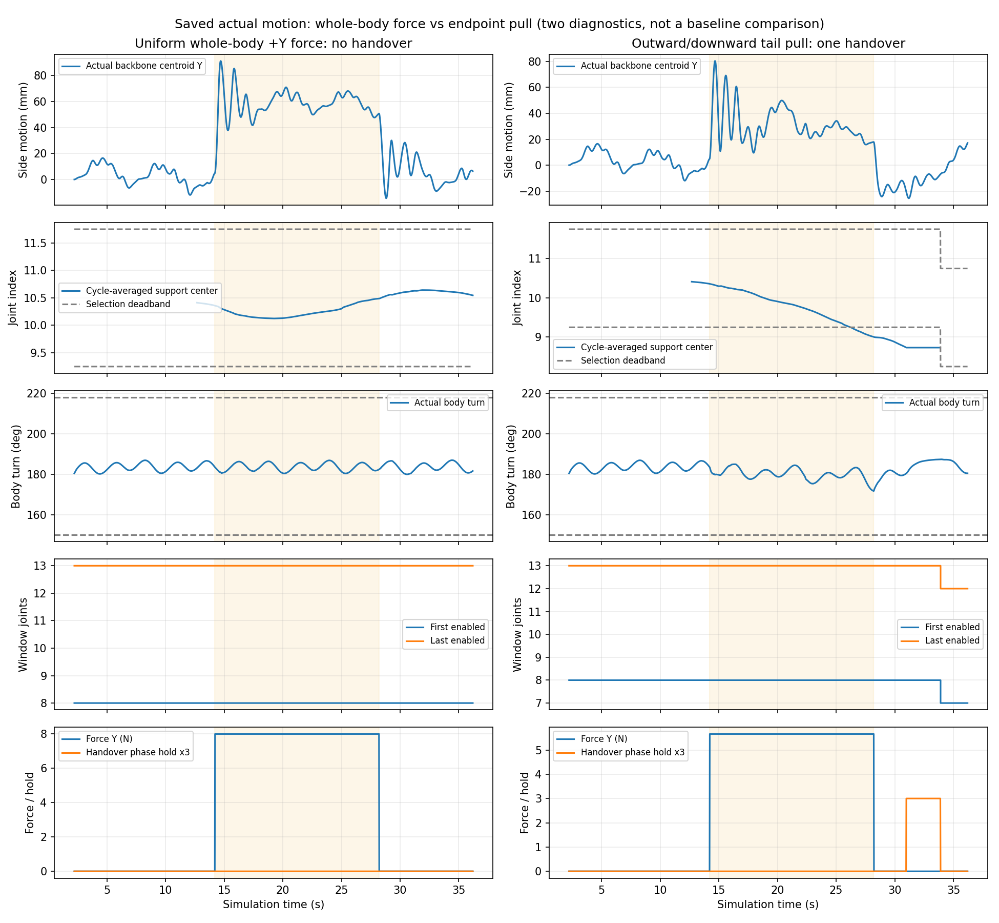
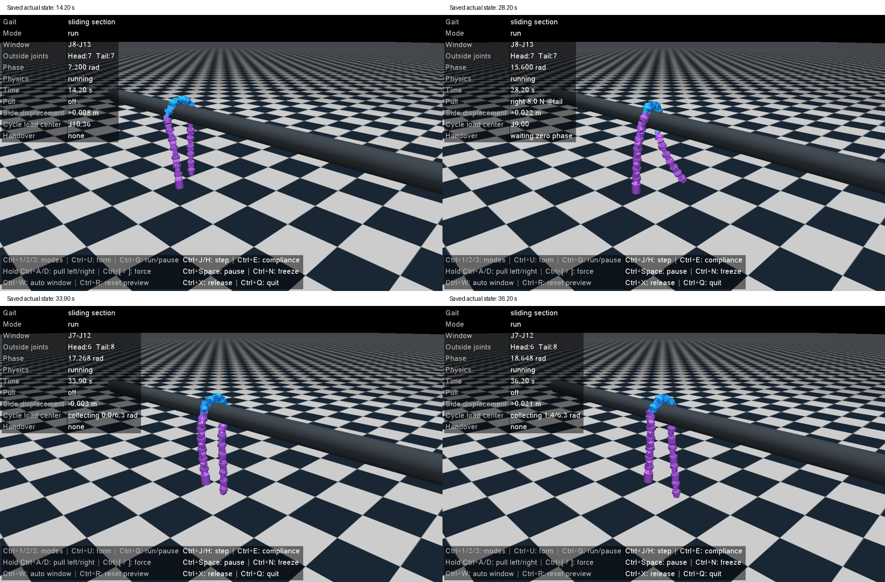

# 三模式与本体左右扰动：检查计划及复盘

本轮只扩展手调界面，复用既有滑动窗口核心，不调整自动研究实验或将滑动模式移植到实机。模式为基础圆弧、固定截面顺应和滑动窗口截面顺应。“左右”操作施加物理横向力，不手工移动使能窗口、不直接设置机器人位姿或速度。

固定条件：Conda mujoco环境、已有直管模型、20关节、J8–J13、60°/0.6 rad/s、原PD及被动阻尼。控制输入为实际关节角；滑动模式另读MuJoCo接触承重和实际主动关节力矩。它们不是实机当前可用的观测。

检查数量：既有19项回归一次，新增3项模式/扰动/重新预览检查；另进行1段有明确阶段的直管动力学操作流程。动力学阶段为形成与静置2.2 s→滑动模式无扰动连续12 s→向+Y施加总力8 N共14 s→停止扰动继续8 s。总时长36.2 s，不展开跨管、低阻尼或反馈延迟矩阵。

验收与分析：模式切换保持实际位姿、相位、最近目标和原掩码；松开字母或Ctrl后外力归零；位置目标不回显为实际状态；全程保存实际qpos/qvel、目标、掩码、外力、承重、有效指令周期分布、交接及约束事件。审查全采样和实际横向位移，并分别报告是否触发移窗、等待/拒绝原因和开放形态。未移窗不直接判方法无效，先核对周期偏移、覆盖及卸载条件；不能把外力下的移动称为自主推进。

以上是运行前的冻结计划。窗口外头/尾关节数表示使能分布，不能当作实际接触关节数或以此证明本体滑移。

## 实际执行数量与修复

既有19项检查复跑通过，新增3项针对性检查通过，共22项不同检查。包括模式切换保留实际位姿/相位/目标/掩码、按键重复与松键停止、两方向同时按住外力归零，以及显式重新预览与延后模式接入。修复后仅重跑受影响检查，没有扩大场景矩阵。

动力学共尝试3次，其中2次完整完成36.2 s，1次施力前中断：

| 次序 | 改变的变量与实际结果 | 记录 |
| --- | --- | --- |
| 1 | 均匀分配到整机的8 N水平+Y力；发生本体位移，周期承重偏移未越阈值，未移窗 | `whole_body_trace.jsonl.gz`、`whole_body_summary.json` |
| 2 | 改为端点向外/向下拉动；错误地假定末端body叫`link20`，约14.2 s时中断，尚未施力 | `interrupted_attempt.json` |
| 3 | 修复末端识别，按最后驱动关节所属body元数据取端点；同一36.2 s流程完成一次自动交接 | `endpoint_pull_trace.jsonl.gz`、`endpoint_pull_summary.json` |

追加端点方式前已说明：整机平移不一定迁移关节索引上的承重分布，需改变扰动位置与方向来测试交接。两种扰动的总力均8 N，但后一种Y/向下分量各5.657 N，施力在按下时选定的`tail`；它们不是等条件的算法基线对照，不用来宣称性能提升。

中断尝试在内存前缀序列化之前退出，实际前缀丢失；只保留真实错误、近似时刻与修复说明，**没有用另一轮前缀代替**。新附的单病例复现脚本改为在退出时保存前缀，并另存新目录；未额外执行这份复现脚本。

## 全程检查结果

读取XML数值元数据后确认本病例全程为113 mm直管，关节机械限位±90°；不是110→210 mm变径场景。本轮在已有Conda `mujoco`环境运行（Python3.9.21、MuJoCo3.2.7），没有安装环境或依赖。窗口初始J8–J13，幅值60°、角频率0.6 rad/s；PD=127/1、限扭2.355 N·m、被动阻尼1.5沿用配置。方法参数和固定6关节宽度未变。

两次完整运行各保存1700个实际控制状态，20 ms一个采样；范围2.22–36.20 s，覆盖无扰动、完整施力与松手后恢复。形成和静置2.2 s的动力学已执行，但这两份档案没有保存该前段逐帧状态，不能把该段计入1700采样的审查覆盖。此前形成流程另有[统一手调记录](../manual_debug/README.md)。

| 全保存态审查指标 | 整机水平力 | 端点向外/向下拉动 |
| --- | ---: | ---: |
| 实际身体截面转角 | 179.93–186.95° | 171.68–187.39° |
| 实际开口比例最小值 | 0.5536 | 0.5455 |
| 实际截面平面拟合RMS最大值 | 8.44 mm | 8.44 mm |
| 实际投影平滑曲线最小曲率半径 | 52.67 mm | 52.12 mm |
| 发送目标最大转角 / 最小开口 | 186.69° / 0.5555 | 187.33° / 0.5462 |
| 主动关节数 / 失能关节主动力矩最大值 | 始终6 / 0 | 始终6 / 0 |
| 实际主动力矩最大值 | 1.223 N·m | 1.883 N·m |
| 饱和采样数 / 机械越限采样数 | 0 / 0 | 0 / 0 |
| 管道向上支撑合计 | 24.67–31.05 N | 25.40–35.49 N |
| 实际最大关节角 / 最小限位裕度 | 62.97° / 27.03° | 63.50° / 26.50° |
| 成功窗口交接次数 | 0 | 1 |

实际开放指标按身体局部截面评价，要求150–218°、开口≥0.4、RMS≤15 mm；不能把这个身体转角写成严格绕管轴包绕角。平滑曲率半径来自实测角重建后的投影圆弧，不是管径。两轮没有累计收紧趋势，实际身体开放指标通过；发送目标约束违规计数均0，形态阻塞采样均0。

完整qpos/qvel均有限。以上力矩、限位与形态结论覆盖50 Hz保存态，不声称排除了1 ms子步的全部峰值。全部保存态做几何重建，最低骨架高度分别0.648/0.596 m，没有重建出的地板接触；原日志未保存地板法向力，不能给出原始地板力验收。此病例没有跨越障碍，因而“越障后的持续运动”不适用。

无扰动12 s内的Y位置峰峰值约28.44 mm，起止差+4.76 mm；与滚动相位相关的左右摆动存在。施力阶段整机/端点Y峰峰值为86.07/75.02 mm，起止差为45.66/12.62 mm。松手后仍有振荡，不能仅凭净位移评估侧移程度，也没有据此证明自主侧移或无长期漂移。全段沿X移动0.644/0.594 m是当前滚动的实际运动记录，不作为效率对比。



图中橙色背景为施力阶段，承重中心只有收集到完整2π指令相位后才显示；移窗后旧周期历史清空。曲线包括最差开放状态和松手后的8 s，而不只展示成功交接瞬间。

## 为什么第一轮未移窗，第二轮如何交接

第一轮周期承重中心最远偏离窗口中点J10.5约0.375关节，低于1.25关节阈值，故未申请移窗。**已确认**的是定位条件未达到；整机分布力主要移动/摆动身体、没有充分改变承重关节分布，是结合实际记录的原因判断，置信度中等。身体已动不等于控制器该移窗，不能把这轮直接判为算法失败。

端点拉动后，施力阶段周期承重中心最低J9.004，偏离中点约1.496关节，越过阈值并持续。自动事件如下：

| 仿真时刻 | 实际事件 |
| --- | --- |
| 27.46 s | 申请J8–J13→J7–J12，等待合适相位 |
| 28.20 s后 | 停止外力，继续滚动/卸载 |
| 30.96 s | 相位17.268 rad暂时保持，开始实际卸载等待 |
| 33.88 s | 检查实际角速/力矩等门槛后，6关节掩码一次性交接完成 |
| 33.90 s | 首个交接完成后的保存态；窗口外头/尾关节数7/7变6/8 |

交接处进入/退出关节角约−0.653/−3.982°，角速0.053/1.320°/s，退出力矩−0.00930 N·m，目标窗口支撑覆盖约1.00；分别满足4°、8°/s、0.2 N·m与覆盖≥0.8的门槛。相位保持2.92 s后完成；所有保存掩码仍为6个主动关节，未出现7关节并集使能。



四图分别为施力前、最小身体转角、首个交接完成后状态、流程终态。三维截图来自实际保存qpos/qvel；目标轨迹不用于证明运动。界面已做隐藏窗口渲染与关闭检查，文字和机器人均可见。完整实际状态回放视频在本机`validation/results/debug_modes/endpoint_pull_full.mp4`，10 fps、2.22–36.20 s；视频不入Git。

## 本轮目标、问题与下一项最小验证

**满足本轮手调功能目标**：三模式能在线切换，左右操作通过物理力移动本体，自动窗口在一次有足够承重迁移的病例中自行交接，窗口外保持失能，身体保持开放。基础/固定实现继续共用实机；实机新增的仅是通用监听器可选解码参数与帮助文本扩展，默认串口控制、热键和控制算法不变，滑动模式没有移植。

发现的问题包括：整机横向力不够直接地测试承重迁移；末端命名假设导致中断且前缀丢失，已改用模型元数据并在复现工具补前缀存档；拉动与松手造成明显瞬态侧摆，已保留完整响应，没有只报终点差值。未发现窗口收紧、保存态饱和或越限，审查范围限于上述两段完整实际采样。

尚未验证：真实Windows热键操作、实机效果、负方向的完整自动交接、双向反复交接、交接后长期稳定和手调版完整跨管矩阵。新代码没有连接串口或注入操作系统按键。交接后只有2.32 s、相位再推进约1.38 rad，未满新周期，不能宣称长期稳定。

下一项最小验证建议由人工使用同一入口，在一个完整周期内持续拉动再松手，检查右/左其中尚未覆盖的自动交接；本轮不追加该实验。外力与自动窗口目的已分开，用户可以直接操作观察，而不靠人为改使能范围假装滑动有效。

## 资料与按需复现

- `endpoint_pull_trace.jsonl.gz`、`whole_body_trace.jsonl.gz`：两份完整已保存实际状态。
- 两份`*_summary.json`、`*_console.txt`：实际事件、阶段汇总及控制台输出。
- `full_state_audit.json`：全采样形态、支撑、失能、限位与饱和审查结果。
- `interrupted_attempt.json`：中断原因和缺失原始前缀的诚实说明。
- `actual_1.png`至`actual_4.png`：可单独查看的三维实际状态图。

只重建现有数据的图与审查，不新增实验：

```powershell
conda activate mujoco
python validation/audit_debug_modes.py
# 可选：生成本地完整保存态视频
python validation/audit_debug_modes.py --video
```

需要重新跑这一个病例时才执行以下脚本，另存新目录；本轮已完成后不再自动重复：

```powershell
python validation/reports/debug_modes/run_endpoint_pull.py
```

针对性检查命令：

```powershell
python -m unittest validation.test_real_controller validation.test_real_step2 validation.test_manual_debug validation.test_debug_modes -v
```
