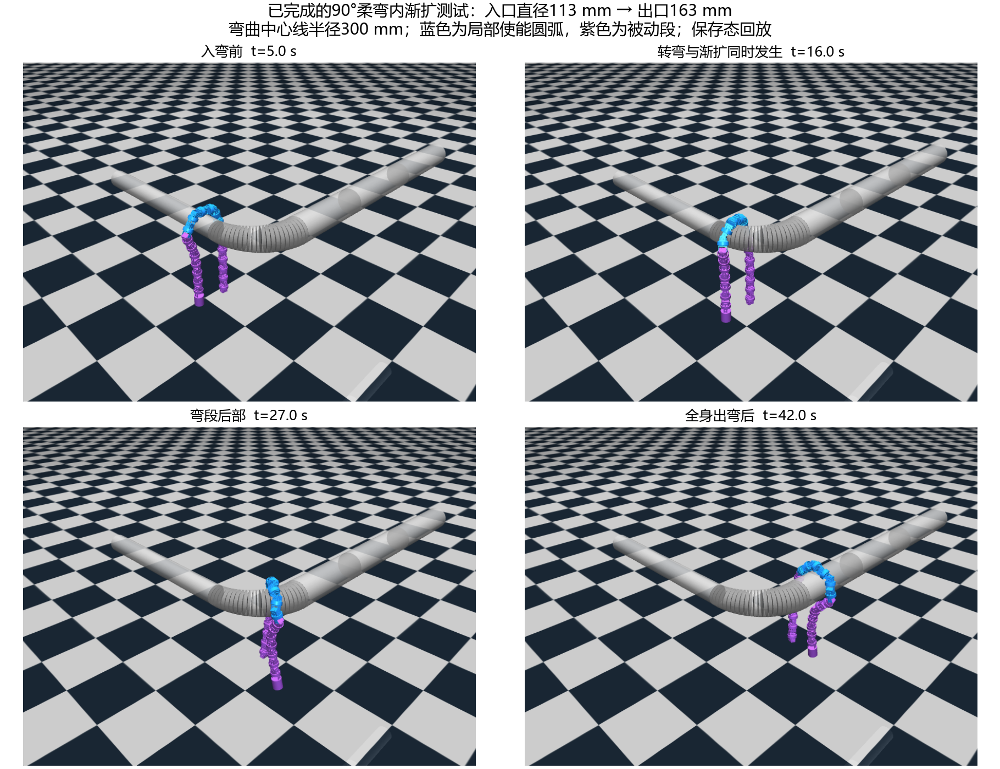

# 固定窗口截面顺应实验记录

本批次按 `docs/固定窗口截面顺应实验计划.md` 执行。正式控制独立于可视化 EXE，仅使用关节角、机械尺寸、固定窗口和滚动相位。实机代码冻结。没有进行反馈延迟、低阻尼验证。

完成日期：2026-10-12。共18次动力学运行：原计划16次，90°相位初始化不合格后追加2次替换。实验方案已全部执行；直管、两类变径直管、柔弯及两类变径弯通过本批次检查。连续90°急弯完成运动通过，但拐角处包绕角不可观测，完整数值形态验收保留未确认。没有为取得全通过更改门槛或重复运行急弯。

固定条件：20关节机器人，J8–J13固定使能，60°名义幅值、0.6 rad/s，2.355 N·m限矩，被动阻尼1.5 N·m·s/rad；基础电机/摩擦条件不变。变化的是几何反馈/增益及已声明的场景；窗口不在线改变。每轮假设是实际形状反馈能在开放约束下保持支撑与滚动，控制是否有性能优势由同条件基础对照判断。

| 新方法主要场景（K=0.02） | 实际运行时间 | 推进 | 最大有效管轴包绕 | 出口观察 | 判定 |
| --- | ---: | ---: | ---: | ---: | --- |
| 恒径直管 | 34 s | 0.601 m | 215.32° | 持续3周期 | 通过 |
| 小幅渐扩—渐缩 | 110 s | 2.060 m | 215.66° | 38.30 s | 通过 |
| 113→163 mm突变 | 58.801 s | 1.067 m | 215.32° | 31.501 s | 通过 |
| 90°柔弯 | 71.701 s | 1.352 m | 215.62° | 31.500 s | 通过 |
| 连续90°急弯 | 61.301 s | 1.108 m | 216.08°，仅有效区间 | 31.501 s | 运动通过；拐角形态验收未确认 |
| 既有45°变径弯 | 88.600 s | 1.643 m | 215.32° | 31.499 s | 通过 |
| 真90°渐变径弯 | 72.001 s | 1.360 m | 215.36° | 31.500 s | 通过 |

每项是已声明条件下的一次结果，认可该条件下成果，不据此推断统计通过率。基础步态也通过直管变径，新方法的推进、机械功和通过率优势尚未证实；拟合身体半径没有构成精确管径跟踪证据。实现和调参见[设计说明](../../../docs/固定窗口截面顺应设计.md)。

## R0：移植与基础形态（1次动力学、8个几何输入）

- C# 原源码只读编译的对照：8个姿态覆盖两种起始奇偶和4个滚动相位。Python 正运动学最大差异约2.22e-16 m；原规则曲线转角差异不超过1.4e-15 rad，轴方向一致。另用已有实际轨迹4帧核对MuJoCo骨架，刚体坐标配准后最大点误差约5.9e-16 m。
- Step1直管34 s，推进0.602 m，实际包绕最大212.71°。这是离散机器人实际形态，不是理想180°圆弧。
- 新实验前冻结：目标连续截面总转角≤190°，实际管轴包绕150°–218°（基础最大值加5°后取整），端部间距/主动骨架长度≥0.4。218°是本批次工程容差，不等于精确半圆；保留名义180°及实际偏差，不以“不到一圈”替代验收。
- 评价真值与控制估计分开；短圆弧部署轴采用主动段拟合平面，原pitch-variance算法保留用于移植对照。这是开放圆弧扩展，不能称为原2023全螺旋控制器原样复现。

## R1：冻结相位（计划4次，初始化问题追加2次）

- 0相位：K=0最大213.46°；K=0.02最大216.69°。初始收紧后趋于稳定，未发生持续闭合，支撑与失能检查通过。
- 原90°理想姿态直接放置产生过大启动碰撞；自动门槛曾通过，但人工复盘将两条记录标为实验初始化不合格，保留证据。
- 最小修复：读取R0真实到达约1.56 rad的相同状态，再分别以K=0和0.02冻结30 s。最大包绕208.46°/212.30°，推进漂移约4.9/4.8 mm，末段形态稳定。两组支撑、开放、目标约束通过。
- 原因判断：原异常由放置姿态与管轴关系引起，不能归为顺应算法不稳定。保存态接管消除了这项初始化混淆。限于两个冻结相位，不推断所有摆放均可接管。
- 已查看全时程指标与侧视/端视帧，接下来仅执行计划内2次连续滚动。

## R2：连续滚动（2次，均34 s）

- K=0推进0.5927 m，最大包绕212.47°；K=0.02推进0.6009 m，最大215.32°。基础R0推进0.6020 m。形态、支撑、限矩、失能及目标约束均通过。
- 已生成整个运动视频及侧视/端视分镜，查看完整时间曲线和运动阶段。形态按相位周期变化，未观察到逐周期向闭合漂移；K>0目标截面仍在190°以内。
- 当前收益是建立并验证几何反馈链与开放约束，没有证据证明速度、效率或通过率优势。非圆投影的圆拟合半径是身体几何描述，不等于管道半径。
- 下一轮仅3次小幅渐扩-渐缩对照。新场景管半径56.5→62.15→56.5 mm；33个连续凸台体拼接，实际运行前记录范围、出口长度和固定窗口。

## R3：小幅渐扩—渐缩（3次，各110 s）

- 基础 / K=0 / K=0.02推进分别2.050 / 2.041 / 2.060 m；最大实际包绕212.77° / 212.99° / 215.66°。三组固定窗口、开放、支撑检查均通过。
- 全身体越过变化段的时间分别71.70 / 72.50 / 71.70 s，出口观察38.30 / 37.50 / 38.30 s，均超过3个周期。完整时间曲线与变径中、缩径中及最后多个周期的侧视/端视分镜未见持续收紧。
- 基线同样通过，不能声称通过率优势。K>0正机械功218.21 J，基础207.51 J，本场景也没有节能证据。投影圆拟合半径受到相位和非圆形态影响，不能作为精确管径跟踪的证据。
- 已验证的是小幅变径下保持开放并继续推进；几何反馈相对基线的收益尚待较大变径评价。下一轮仅2次既有113→163 mm对照，最长70 s，全身越过后记录3个周期即可停止；不改变冻结门槛。

## R4：113→163 mm突变直管（2次）

- 基础与K=0.02全部检查通过；推进1.058 / 1.067 m，最大实际包绕212.71° / 215.32°。全身体越过分别27.10 / 27.30 s，之后各观察31.501 s（3周期），开放形态稳定。
- 查看全时程曲线和变径中、出口及最差状态的侧视/端视分镜：大管段实际包绕约182–188°，未闭合；目标连续截面仍受190°约束。正机械功110.53 / 114.98 J，仍不能声称能耗优势。
- 问题：圆拟合身体半径几乎维持相位周期，不能把通过当成准确半径跟踪。当前步态本身已有通过能力；本轮确认几何反馈未破坏较大变径通过，尚未证明它优于基础控制。
- 下一轮4次新方法：90°柔弯、连续90°急弯、既有45°变径弯、真90°渐变径弯。前三个仅复制并延长出口直段1.2 m，障碍部分不变；分别最长100 / 90 / 120 / 120 s，全身出弯后观察3周期即停止。延长出口用于排除管道末端干扰，不修改关节阻尼、反馈或冻结门槛。

## R5：弯管（4次，没有追加动力学）

下图为已经完成的真90°渐变径弯实际保存态：管径在90°柔弯内部连续从113增至163 mm，弯曲中心线半径300 mm。固定整体视角用于看清转弯与变径同时发生；管道半透明仅用于显示。该图通过`py -3.12 -X utf8 validation/render_section_overview.py`回放生成，没有追加实验。



- 90°柔弯、45°变径弯、真90°渐变径弯全部检查通过。实际运行分别71.701 / 88.600 / 72.001 s，推进1.352 / 1.643 / 1.360 m。全身出弯后各观察约31.5 s（3周期）。全时程、弯中、最差状态和出口分镜未见持续收紧；目标、失能、支撑、限位、限矩和数值稳定均符合门槛。
- 连续90°急弯在29.8 s全身出弯，继续观察31.501 s，推进1.108 m。其106个保存样本（10.001–20.5 s）跨越两个相差90°的最近管轴方向，原单截面包绕量不可观测，`shape_observable=false`，总判定保留`passed=false`。有效区间最大216.08°符合门槛，不能借此忽略无效区间。
- 问题证据：原始投影角在20.5 s为285.35°，20.6 s为212.29°；同时间局部平面误差约0.20→0.80 mm，没有对应的突然身体展开。完整分镜中主体仍为开放圆弧。结合最近管轴从90°跨度变为0°跨度，原因高度支持评价坐标在拐角切换，而非突然收紧成螺旋。急弯中有真实非平面变形，不能简单视为严格平面。
- 补充保存态审查：无效区间实际局部连续截面总转角164.89°–185.90°，开口比≥0.5571，平面拟合误差最大8.35 mm；出口最后三个周期峰值215.18° / 215.30° / 215.34°。这些结果支持开放且未持续收紧，但不替代被冻结的单管轴数值验收，详见[r5_elbow90_geometry_audit.json](r5_elbow90_geometry_audit.json)。
- 正式控制与评价均未借助步态转换。急弯物理管道连续，没有截断口。新增真90°渐变径弯的管道半径56.5→81.5 mm，变径发生在300 mm中心线半径的90°弯段；它与既有突变后45°弯的组合不同，分别记录。
- 下一项最小研究建议：若后续要求急弯也有统一数值形态判定，先定义弯角处的三维/分段开放量并冻结门槛，再复用本次完整保存态评价。本批次不直接追加试验，不开始滑窗或实机移植。

## 保存态复盘与下发目标审查

全程以100 ms采样保存真实`qpos/qvel`、骨架、目标、使能掩码、力矩、轴与截面曲线，以及仅用于评价的接触/管径。动力学每1 ms只调用`mj_step`；根部仅在初始化或读取初态时设置，记录回放中的设置不属于控制。

除滤波前候选检查，另对9条连续新方法轨迹的**实际下发目标**重建截面：最大187.45°，最小开口比0.5518，全部满足原190°/0.4门槛。结果见[sent_target_geometry_audit.json](sent_target_geometry_audit.json)。这项是复盘已保存状态，不增加动力学次数。

已查看各轮整个时间曲线及覆盖全过程的侧视/端视分镜，重点审查障碍中、最差状态、出口及继续滚动。R2–R5共11个全程视频保存在本目录`*_full.mp4`，视频不进入Git；原始状态及渲染代码入库。R5渲染管道半透明，仅解除轴向遮挡，不修改实际碰撞或状态。急弯不可观测帧明确标注，不以原始285°投影当成真实包绕角。

- [较大变径完整指标](r4_large_k2_review.png)
- [真90°变径弯完整指标](r5_taper90_review.png)、[弯中侧视与端视](r5_taper90_filmstrip3.png)
- [急弯完整指标，灰线为无效投影](r5_elbow90_review.png)、[拐角状态](r5_elbow90_filmstrip2.png)

## 复现命令

以下均从仓库根目录运行。默认输出会覆盖同名结果；调试时用`--output validation/results/my_section`另存。不需要重跑整个矩阵才能回看结果。

```powershell
# 一批8个几何移植输入，默认复用已保存C#输出；重建对照加--build-oracle
py -3.12 -X utf8 validation/check_section_geometry.py
# R0基础重新运行可用新实验入口；原存档来自Step1同参数控制
py -3.12 -X utf8 validation/fixed_section_experiment.py --scene straight --label my_r0 --baseline --duration 34 --output validation/results/my_section
# R1有效冻结相位：各参数各一次，不从90°理想姿态直接初始化
py -3.12 -X utf8 validation/fixed_section_experiment.py --label r1_hold0_k0 --hold-phase 0 --gain 0 --duration 30
py -3.12 -X utf8 validation/fixed_section_experiment.py --label r1_hold0_k2 --hold-phase 0 --gain .02 --duration 30
py -3.12 -X utf8 validation/fixed_section_experiment.py --label r1_hold90_state_k0 --hold-phase 1.56 --gain 0 --duration 30 --initial-state validation/reports/fixed_section/r0_baseline/straight_baseline_trace.npz --initial-index 46
py -3.12 -X utf8 validation/fixed_section_experiment.py --label r1_hold90_state_k2 --hold-phase 1.56 --gain .02 --duration 30 --initial-state validation/reports/fixed_section/r0_baseline/straight_baseline_trace.npz --initial-index 46
# R2
py -3.12 -X utf8 validation/fixed_section_experiment.py --label r2_roll_k0 --gain 0 --duration 34
py -3.12 -X utf8 validation/fixed_section_experiment.py --label r2_roll_k2 --gain .02 --duration 34
# R3：3次；当前完整存档均110秒
py -3.12 -X utf8 validation/fixed_section_experiment.py --scene small_taper_return --label r3_small_base --baseline --duration 110
py -3.12 -X utf8 validation/fixed_section_experiment.py --scene small_taper_return --label r3_small_k0 --gain 0 --duration 110
py -3.12 -X utf8 validation/fixed_section_experiment.py --scene small_taper_return --label r3_small_k2 --gain .02 --duration 110
# R4：2次
py -3.12 -X utf8 validation/fixed_section_experiment.py --scene taper_straight --label r4_large_base --baseline --duration 70 --exit-cycles 3
py -3.12 -X utf8 validation/fixed_section_experiment.py --scene taper_straight --label r4_large_k2 --gain .02 --duration 70 --exit-cycles 3
# R5：4次
py -3.12 -X utf8 validation/fixed_section_experiment.py --scene bend90_section_exit --label r5_bend90 --start -.35 --duration 100 --exit-cycles 3
py -3.12 -X utf8 validation/fixed_section_experiment.py --scene elbow90_section_exit --label r5_elbow90 --start -.25 --duration 90 --exit-cycles 3
py -3.12 -X utf8 validation/fixed_section_experiment.py --scene taper_bend45_section_exit --label r5_taper45 --start -.5 --duration 120 --exit-cycles 3
py -3.12 -X utf8 validation/fixed_section_experiment.py --scene taper_true90 --label r5_taper90 --start -.35 --duration 120 --exit-cycles 3
# 回放与保存态审查；不新增实验
py -3.12 -X utf8 validation/render_fixed_section.py --labels r5_taper90 r5_elbow90 --video
py -3.12 -X utf8 validation/audit_fixed_section.py
```

本轮未使用参考项目GUI作为控制依赖，未修改实机文件，未连接串口，未推送GitHub，未改用户研究路线或交接记录。旧幅值反馈/滑窗原型的未提交改动保留，未混入新控制提交。
