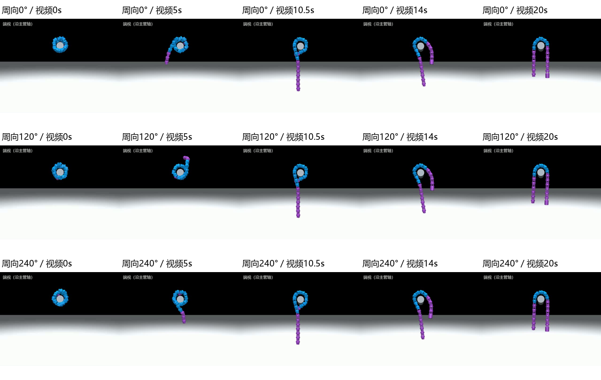

# 18关节：逆向解缠 → 开放半圆ARC → 自动归中

2026-11-08。最终同一版控制器在3个不同周向起态完成全流程，并在归中后继续ARC滚动6 s。此前失败、相交与掉管记录均保留。本轮只改仿真专用模块，没有同步实机或热键入口；没有执行实机实验。

## 结果与视频

| 名义初始周向 | 静置后尾端实际周向¹ | 全流程含续跑 | 续跑实际包绕角 | 续跑最大左右长度差 | 续跑最大沿轴离平面RMS |
| --- | ---: | ---: | ---: | ---: | ---: |
| 0° | −156.94° | 81.25 s | 176.92–181.87° | 33.86 mm | 10.56 mm |
| 120° | −40.96° | 82.05 s | 176.91–181.83° | 35.58 mm | 10.61 mm |
| 240° | 82.66° | 82.25 s | 177.30–182.05° | 35.40 mm | 10.78 mm |

¹在真实MuJoCo初态静置后，以主管截面+y为0°、+z为90°测量，仅供评价。覆盖两个下方起态及一个上方起态，没有用文件名替代实际周向。

三段完整视频均为4倍速、约20–21 s，画面显示阶段、二值使能、控制器估计长度差、相位、已发目标角与实测角。画面全部来自实际状态回放，不绘制目标构型代替物理结果。

- [0°全过程](../../../artifacts/helix_arc_20261108/round5_beta0/helix_arc_4x.mp4)
- [120°全过程](../../../artifacts/helix_arc_20261108/round5_beta120/helix_arc_4x.mp4)
- [240°全过程](../../../artifacts/helix_arc_20261108/round5_beta240/helix_arc_4x.mp4)



三例在形成半圆、自动归中、归中保持及后续滚动的全部保存帧中满足形态判据；归中过程中实际包绕最小约166.7°，未收紧成闭合包绕。后续滚动6 s沿主管推进约72–75 mm；从起态到最终的全身平均轴向净位移约11–17 mm。过程有轴向运动，不属于严格原地切换。

全部保存采样中无自碰撞或触地，失能关节执行器力矩为0，最大实际关节角约78.1°。最大使能角跟踪误差分别1.45°／1.75°／1.68°；力矩饱和保存帧28／34／27，不能称为完全无饱和。120°例归中阶段t≈65 s有1个总接触合力<0.1 N的保存帧，其余两例为0；未出现掉管，不宣称所有时刻持续接触承重。状态、接触与力矩以50 ms保存采样检查，不把它表述成逐1 ms接触证明。

## 固定条件、输入和验收口径

固定18关节、19段64.5 mm旧等轴距模型；主管实际直径110 mm，水平直管，无支管辅助；相同摩擦、2.355 N·m执行器限矩、1.5 N·m·s/rad被动黏性阻尼。初始Helix目标中心线半径94 mm、螺距130 mm，三例只改变绕管周向。真实管道几何由XML中`pipe_main`圆柱核对。

控制器只接收全身关节角、机械尺寸、时间与新样本标志，每200 ms读取一次；不接收根位姿、管道坐标、接触、支撑真值、外部重力向量或MuJoCo状态。初始半径、扭率、相位从实测关节角拟合，未把实验目标半径传入控制器；本组拟合半径约94.06–94.23 mm。失能尾段出现后，以其近直区段推算向下方向，再识别冠顶。早期没有向下参考时仍可执行逆向出管。

定量口径在第二轮独立形态审查前写入[方案](../../../docs/Helix转ARC仿真方案.md)：实际包绕150–220°、端距/弧长≥0.45、沿管轴离平面RMS≤25 mm、冠顶高于轴线40 mm、曲线离轴最大半径<170 mm；后续滚动期间实际两侧悬垂材料长度差≤65 mm。首轮开始前已明确开放半圆、平面性、两端失能与归中目标，未预先固定上述数值。控制器归中目标为25 mm，评价独立使用真实主管轴高平面与实际骨架的交点，二者不混用。最终头尾均失能。

旧模型与用户重装后的转轴中心距尚未统一。本轮结果不能直接代表新机械尺寸或实机阻尼／摩擦条件。

## 实现方法

1. 对交替转轴的角度积分拟合曲率、带符号扭率和相位，从实测形状开始接管。
2. 逆用原回卷的几何变化：直尾以16 mm/s增长，螺旋段相应缩短，配合0.112 rad/s反向相位变化；自由尾段逐段扭矩关闭。初始周向不会被用作控制输入。
3. 剩余约一圈后，用自由尾段估计向下，选择能容纳半圆的顶部材料区间，不要求冠顶强制位于一圈正中。
4. 同时减少扭率和承载曲线长度，按冠顶补偿曲线相位；退出头段先由短过渡曲线导出，再逐段失能。
5. 半圆建立后，继承当前半径与形状；按角反馈估计的两侧长度差移动曲线段界，完成实际送链归中，再继续滚动。没有切回旧Ctrl+4的固定60°初始模板。

这是原回卷曲线的逆向展开及相位配合，不是整个原程序逐帧倒放。为消除观测到的干涉，出管过渡在螺旋导程角之外增加30°；压平时增加最高40°的短暂正交头端弯曲，按角度重建的几何距离选择绕行方向，最后消除该弯曲。两项均是曲线段参数，不使用接触真值。

## 每轮复盘与失败证据

共9次动力学运行：6次先导／排错，最终同版3例；没有扫描额外场景。

| 轮次／目录（位于本机artifacts/helix_arc_20261108） | 改变和实际结论 | 问题、原因判断与下一项最小验证 |
| --- | --- | --- |
| round1_beta0 | 逆解缠后保持管上，但150 s结束时仍在调相 | 冠顶要求位于剩余一圈正中±35 mm，实际冠顶约380 mm而目标303 mm；持续调相未改变这一材料位置。该条件与动作不匹配（高置信）。改用半圆两侧长度是否够用。 |
| round2_beta0／120／240 | 三例均到归中及ARC滚动，但全程验收失败 | 压平时头端扫过尾段；保存自接触帧21／52／21。其中120°另有37帧发生于逆解缠，尾段退出后回落至前部。不是只看最终半圆就通过。 |
| round3_beta0 | 延后头端失能，完成归中，但仍有13帧自接触 | 保持使能减少干涉，几何扫掠路径仍相交；单独改变释放时序不够。 |
| round4_beta0 | 尝试剩余0.7圈后转换，归中阶段掉管，失败 | 较小承载预算下当前送链过程不稳定；末段失去有效两侧交点并掉管。具体载荷／相位贡献未分解，不能断言仅由某个关节数量造成。撤回0.7圈。 |
| round5_beta0／120／240 | 保留一圈，出管与头端各加短过渡绕行；三例完整通过 | 全程形态和自接触审查通过；仍记录饱和及120°的1帧近零支撑。碰撞位置与几何扫掠解释一致，原因判断中高置信；未做额外消融区分两项几何修改各自的贡献。 |

失败与成功的原始`locked_gait.json`、`locked_gait_trace.npz`、`controller.json`保留；后续运行另存了控制器和实验入口源快照。最初先导没有单独源快照，原阈值和运行数据仍保留，不将其伪装成最终代码运行。原始JSON中的`passed`只代表状态机到达ARC滚动，最终是否通过以`shape_review.json`和本报告为准。

## 范围与下一步

已验证：这3个周向、相同直管和Helix形态下，不先识别逐关节接触力，也能靠逆向曲线展开建立自由尾段，完成开放半圆和自动归中。达到本轮仿真目标。

未验证：所有连续周向、任意非理想Helix、其他绕向／管径、弯管、真实重装机械尺寸及实机效果；后续滚动只检查6 s。没有把3例成功外推成任意初态保证。

下一项最小工作是在用户验收视频后，再规划实机单步迁移，首先检查真实尾端退出及头端绕行。当前实机、Ctrl+4/5/6和手动仿真入口保持原实现，不因这次仿真自行更新。

## 复现

沿用现有`mujoco` Conda环境：

```powershell
python .\validation\helix_arc_experiment.py --beta 0 --output artifacts/helix_arc_recheck/beta0
python .\validation\review_helix_arc.py artifacts/helix_arc_recheck/beta0
python .\validation\render_helix_arc.py artifacts/helix_arc_recheck/beta0
```

其余两例将`--beta`改为120、240并另设输出目录。控制参数集中在`snake_control/helix_arc_transition.py`的`HelixArcOptions`；本轮未安装或修改MuJoCo环境。小型数值结果见[results.json](results.json)。视频按仓库规则保留在本地，不加入Git。
