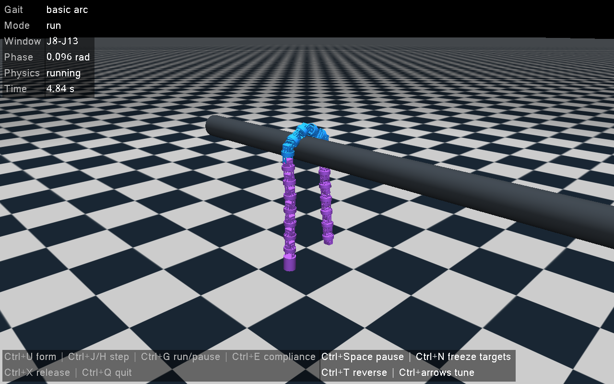

# 无参数启动与统一Ctrl手动调试检查（2026-10-12）

本轮假设：实机和手调仿真使用同一控制器、命令分派、热键监听及反馈调度后，可共享操作语义。固定20关节、J8–J13、60°/0.6 rad/s及已有直管模型，不改变研究算法或跨管判据；改变的是启动配置方式和MuJoCo关节后端。验收只检查操作、真实状态读角、失能、反馈及渲染，不把短流程当作管道通过或长期开放形态证明。

Conda环境`mujoco`，Python 3.9.21、MuJoCo 3.2.7、NumPy 1.23.5。共19项检查全部通过：15项既有算法/协议检查、2项无参数实机入口检查、2项手调后端/操作流程检查。真实串口构造器被替换或禁止调用，没有连接机器人。

```powershell
conda activate mujoco
python -X utf8 -m unittest validation.test_real_controller validation.test_real_step2 validation.test_manual_debug -v
```

一条虚拟Ctrl按键流程驱动真实MuJoCo动力学：普通字母/F键无效→Ctrl+U→正反单步→开启顺应→连续→暂停相位→冻结目标→关闭顺应→反向连续→失能→退出。实际动力学时间4.92 s，共254个保存状态；全采样有限，使能数只出现0/6，窗口外主动执行器力矩为零，顺应未出现形态阻塞。暂停/冻结后物理时间仍增加；发送位置目标不会直接改写qpos。验证了模拟CH340唯一选择、缺失/多个设备拒绝自动选择、顶部固定端口覆盖、启动等待热键、同时间戳日志也不覆盖。

证据：[完整实际状态与控制记录](interaction_trace.jsonl.gz)、[检查摘要](summary.json)。初始静态预览没有运行物理，不能评价承重；模型关节角是控制输入，qpos/qvel/实际力矩是检查真值，电流和协议负载字段为null。

用流程内保存的实际姿态检查1280×800三维窗口的隐藏渲染和关闭，画面显示目标模式、相位及使能配色。检查时发现MuJoCo 3.2.7的MjvScene没有free()方法，已改为绑定析构释放场景，显式释放渲染上下文；最终渲染与关闭通过。



此次完整审查短操作流程及全部状态，没有发现新增控制失能/形态阻塞问题；没有审查整条管道通过、长周期开放形态或所有场景，也没有实际注入操作系统按键，不能宣称实机通过或排除长期问题。仿真使用PD和连续角反馈，实际舵机有自身位置环、量化和串口耗时，两者物理响应仍不同。

达到本轮“入口简化与两端统一操作”目标。下一项最小验证由用户直接打开手调入口按Ctrl+U/J/E确认本机实际热键，再按同样步骤操作实机；自动研究入口及既有动力学结果保留，没有扩大实验矩阵。[操作与参数位置](../../../docs/仿真实机统一调试说明.md)
