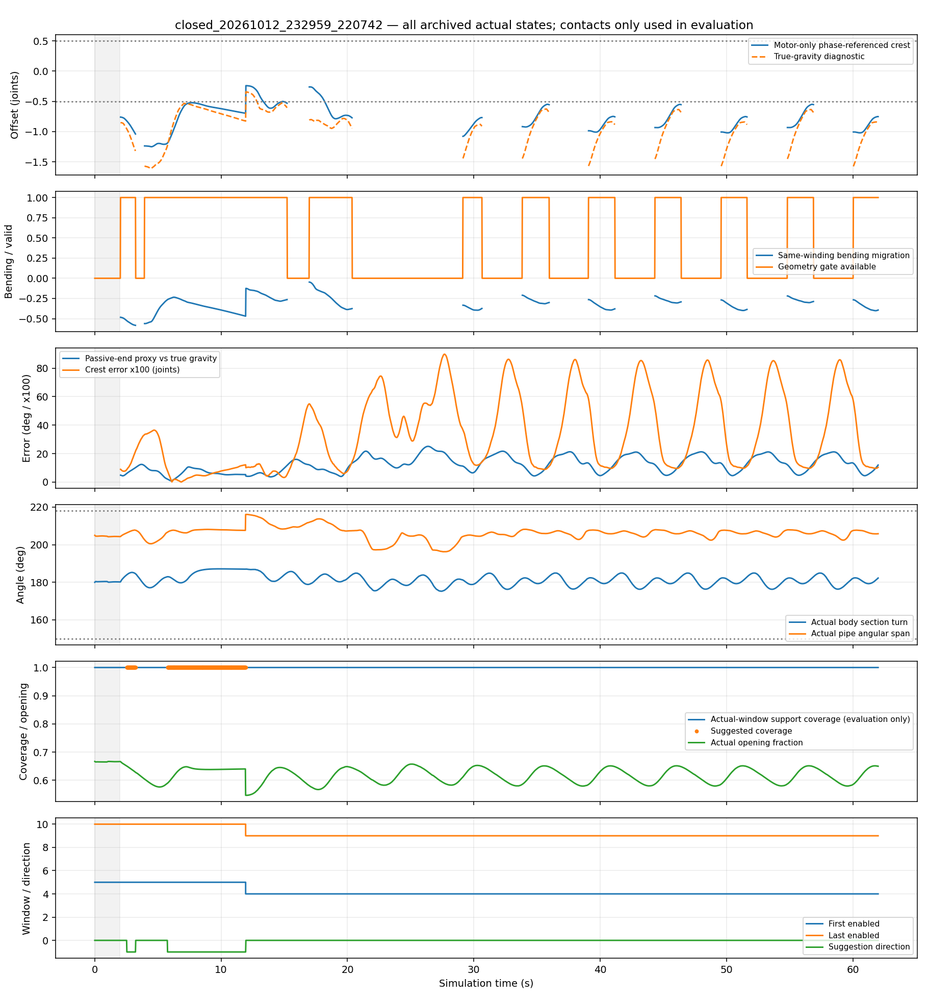
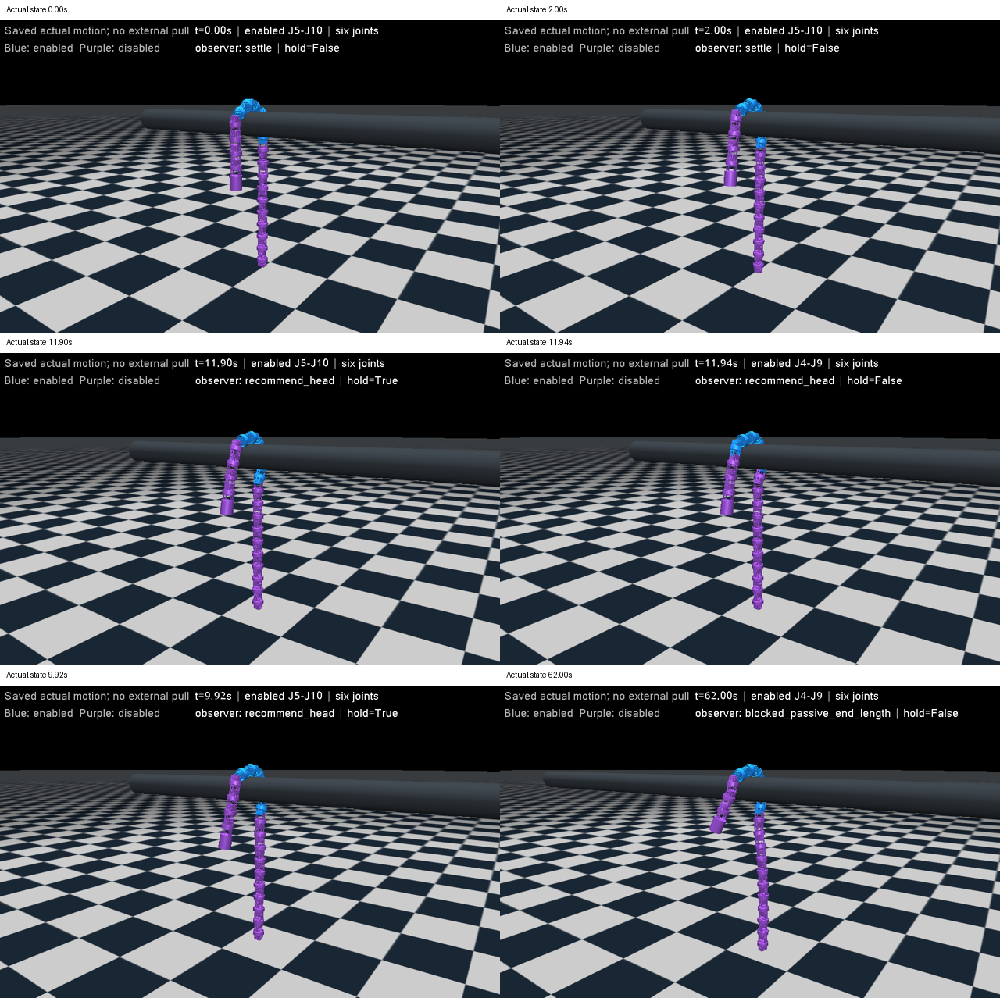

# 六关节、仅实机可读反馈的自动滑窗实验

**本轮完成了仿真开发与一次自动相邻交接验证：不读取接触力或执行器力矩，J5–J10自动变为J4–J9，交接后持续约4.78个指令周期，实际圆弧始终开放。尚未实现全相位可靠观察，也未证明长期反复移窗、实机复现或相对固定窗口的收益。本次开发未更新实机方法，用户本地实机参数改动独立保留。**

## 冻结条件与实际次数

预先计划在[实验计划](../../../docs/实机反馈固定宽度滑窗实验计划.md)，方法在[设计说明](../../../docs/仅电机反馈滑窗设计.md)。本轮只新增**2次动力学实验**：观察一次、通过审查后同条件闭环一次，各62 s，静置2 s后滚动60 s。没有侧拉、反馈延迟/阻尼扫描、其他管径或弯管扩展。

核对模型为水平X轴直管，直径113 mm，轴线z=1.2 m、x=-1.2..1.8 m，管摩擦2/0.005/0.002。20关节初始使能J5–J10，两侧失能4/10关节；两个初始完整qpos完全相同。每节136 g，链长64.5 mm，幅值60°、omega=0.6、位置PD127/1、限矩2.355 N·m；被动阻尼1.5、armature 0.01保持一致且不随失能消失，未标定成真实失能机械参数。沿用已有Conda `mujoco`，无安装。

外层只收到同步20 ms新角反馈、时刻、已知相位和掩码。实际世界姿态、接触与力矩只用于离线评价；按反馈时刻匹配上一保存状态，避免20 ms错配。模型速度只用于内层PD，外层角速度从新角差分得到。t=0已按名义圆弧搭管，未测试从直线/任意姿态形成圆弧。

此前两段侧拉记录完成2次完整离线分析：第一版绝对角弯曲中心漏判端点松手迁移；改为同旋向曲率后重放，阈值未调整。首版输出/代码/参考保存在`first_pass_absolute_turns/`。一个廉价特征检查曾用错端点文件名，修正后才继续，不是动力学尝试。8项针对性软件检查覆盖原几何组件、反向折弯、局部相位、六关节交接、反馈中断、手调接口无接触输入等；最终核心重放两次实验6200组原始角输入，已发目标/相位最大差均0、掩码无不一致，交接事件及时间完全相同。手调做了命令回调和实际HUD渲染检查（`manual_panel.png`），没有实际键盘人工测试。

## 已有记录复盘

冻结参考取共同正常段524个样本，留出76个（约1.52 s）。600个正常样本均无最终建议；其中大部分用于标定，不能称为完整独立正常周期验证。端点松手后28.98 s识别头向迁移，早于原接触控制器33.88 s掩码切换，恢复共208帧建议，含原掩码变化后的再次建议；这些仅为离线观察，必要性没有被证明。

持续端点拉动仍仅15/700帧具备判断条件，没有建议；整机人工侧拉产生2帧头向建议（16.42–16.44 s），原窗口同样覆盖支撑。因共同方向偏差，该外力条件没有通过可靠定位，不把它写成成功或已消除误判。

## 第一例：只观察、偏置搭管自然演化

记录为`observe_20261012_232452_922019/`，3101个保存状态（含初始/静置），62000个物理时步。完整过程出现头向几何偏移，2.54 s的保存状态首次带建议；944帧建议全部与真重力参照方向/候选支持覆盖相符，建议时方向误差最大12.28°。具备几何判断条件58.2%，1253个滚动样本因两端方向不一致被拒绝，501个候选不开放。

实际身体截面177.09–185.67°，开口最低0.570，平面RMS最高8.37 mm；绕真实直管轴的角跨度200.51–210.57°，没有闭合包绕。光滑截面最小局部半径52.65 mm，最低骨架高度0.436 m，支持力最低26.16 N。使能始终6，失能主动矩0，1 ms记录无落地/越限；有318个主动关节时步达到限矩，不能称为无饱和。

**发现的问题：** 没有人工侧拉，观察器仍不是全程可用；自然悬垂不能被当作每个滚动相位都严格成立的重力传感器。拒绝原因和相位周期关联已确认；滚动惯性、机械阻尼与两侧长度差各占多少尚未分解，原因判断置信度中等，不追加扫参。候选与当前窗口均覆盖全部支撑，不能据944帧建议声称必须移窗或提高承重。本例只是偏置搭管后的自然形态偏移，不能等同长期持续滑动的全部情况。

经过实际方向、候选形态与支持审查后，允许一例同条件闭环，不用额外场景扩大样本。

## 第二例：仅角度闭环

记录为`closed_20261012_232959_220742/`。2.52 s控制器准备J4–J9，7.22 s在偶数族零相位保持，11.92 s完成交接：进入J4、退出J10，五个重叠关节不重置。保持约4.70 s；此方法有明显等待代价，不是无停顿或即时跟随。

交接角为3.91°/0.58°，差分角速-1.23/-0.003°/s，候选实际截面187.01°、开口0.547。事后保存状态评价退出关节主动矩约0.0057 N·m，交接前后向上支持28.02/28.09 N；这些没有进入控制器，不能把一次符合低输出的结果当成普遍卸载证明。20 ms内最大关节角变化0.257°，没有重新设置物理位姿。

| 全程实际指标 | 观察 | 闭环 |
| --- | ---: | ---: |
| 身体截面转角 | 177.09–185.67° | 175.22–187.13° |
| 开口最低 | 0.570 | 0.546 |
| 平面RMS最高 | 8.37 mm | 8.43 mm |
| 真实管轴角跨度 | 200.51–210.57° | 196.25–216.10° |
| 光滑截面最小局部半径 | 52.65 mm | 51.98 mm |
| 最低向上支持 | 26.16 N | 25.79 N |
| 最低骨架高度 | 0.436 m | 0.362 m |
| 使能/失能主动矩 | 6 / 0 N·m | 6 / 0 N·m |
| 1 ms落地/越限 | 0 / 0 | 0 / 0 |
| 限矩关节时步 | 318 | 569 |
| 几何观察可用 | 58.2% | 49.77% |
| 自动交接 | 0（只观察） | 1 |

全部滚动保存态通过身体开放条件；另外计算管轴角跨度，不用平面性替代包绕检查。不是严格180°贴管半圆，而是当前工程开放范围内的圆弧。交接后继续约4.78个指令周期，无再次交接、闭合收紧、落地或失能输出。没有越障，本轮不评价跨管后状态。

**发现的问题及边界：** 闭环1506个滚动样本因末端方向不一致不可判断；移到J4–J9后901个样本因候选需要少于3个头侧被动关节而拒绝继续移窗。有效样本重力方向误差最高14.28°，所有样本最高25.09°。因此本轮并没有证明整个身体都能被持续跟踪。当前/建议支撑覆盖都为1，固定窗口也通过开放与承重，闭环不能宣称通过率、效率或承重优势。两例骨架均值沿X推进约1.15/1.06 m，差异包含相位等待，不能仅用这个数字评价效率。





## 研究目标与下一步

“仅实机可读信息、6关节、仿真一次自动交接并保持开放”的阶段目标达到；“可靠长期反复滑窗和实机复现”未达到。本轮数量已用完，不追加动力学试验。先供用户验收；验收前不更新实机代码。

后续最小改进应处理自然滚动时方向观察间歇失效，以及短被动端的定位范围，先用本轮全程记录检查仅角度的单端可信选择/重力无关边界定位能否解决，不直接放宽两端一致性阈值，也不靠扩窗掩盖定位问题。反馈扫读、真实失能阻力、其他管径、急弯、反向与长期重复交接均尚未验证。

## 文件与复现

- 两个运行目录：`actual_trace.jsonl.gz`、参数/场景/1 ms统计`status.json`、逐帧独立评价`evaluation.jsonl.gz`、完整审查`audit.json`、全程图、6张实际状态图和拼图。
- `offline_summary.json`及两份`*_motor_observer.jsonl.gz`：旧记录最终离线复盘；首版完整保留。
- `observation_review.json`、`cause_audit.json`、`final_core_replay.json`：第二例执行依据、失效原因/交接评价、最终软件与已发命令一致性。
- `configs/motor_shape_reference.json`：冻结数值和来源；没有接触真值标定。
- 全程实际视频在本机`validation/results/motor_feedback_sliding/`（不入Git），按10 fps回放原保存态，包含初始圆弧/静置/交接/终态，不重新推进动力学。

使用已有`mujoco`环境，在仓库根目录按需回放，以下不产生新动力学：

```powershell
python validation/audit_motor_feedback.py validation/reports/motor_feedback_sliding/closed_20261012_232959_220742
python validation/render_motor_feedback.py validation/reports/motor_feedback_sliding/closed_20261012_232959_220742
python validation/replay_motor_controller.py
```

`validation/motor_feedback_experiment.py`是本轮动力学驱动，已完成观察与`--closed-loop`两个运行，默认次数保护会拒绝第三次；日常手调继续使用`codes/Rolling_Arc_Debug_Mujoco.py`。
