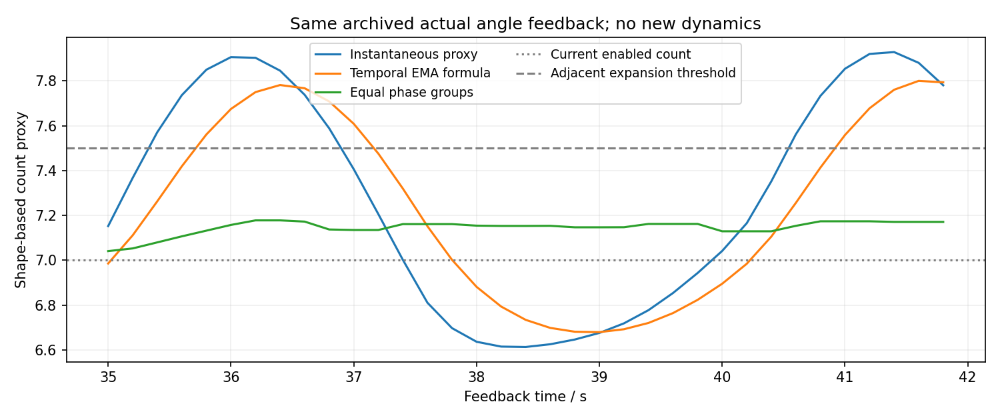

# 相位均衡数量判断：2026-10-13完整复盘

**数量判断的相位起伏明显减少；110→210→110直管真实6→7→6、后续连续移窗与支撑成立，急弯回归身体开放/支撑/持续滚动通过。整体严格形态仍未全部通过：直管修复有53态真实绕管超218°，最大218.669°；急弯单管轴仍存在不可测区。未更新实机或热键入口。**

[冻结计划](../../../docs/相位均衡数量判断实验计划.md)为两个主例、最多一个具体修复。实际3次：直管首例、同病例唯一修复、原急弯回归；总258560动力学步、12931保存态。没有第四次、参数扫描、外力、低阻尼或反馈延迟测试。[当前v3方法](../../../docs/相位均衡数量判断设计.md)说明真实输入与控制/评价边界。

## 已实现的修改

数量代理仍来自实际与同相位名义身体半径/转角。最近π滚动相位按4组中位等权，至少每组2新角；等待交接、试探和冷却时也收集，换窗重置，同相位重复不能制造覆盖。正常运动继续，不需要固定两周期等待。

实际转角先减同相位名义转角再分组，消除名义三维滚动约178°而非恒定180°造成的判断滞后。扩大和紧凑缩小使用相对偏差；没有持续不足的接近名义圆弧可提出相邻短窗试探。仍无6/8白名单或指定返回数，不把姿态等同承重或管径。

只对contract允许退出角≤12°，平移仍4°，其余实际候选、目标开放、下一帧.9°限速、共享预置连续和机械限制保留。不是解除形态约束，更不是确认卸载。

## 同一组既有角度的相位证据

上一轮急弯七关节达到4组覆盖后的**同35个真实角样本**：原始数量6.6133–7.9283，按旧时间过滤公式重算6.6795–7.7999，相位均衡7.0408–7.1778。这是对同输入的过滤公式比较，不是旧控制器整个调度状态的回放。旧信号会越过扩窗门槛，原控制日志也有反复建议；新信号没有。当前急弯真实回归获得同样稳定区间、末态保持七关节。这表明决定更稳定，不是测得最优使能数。

`count_preflight.json`与压缩count_replay保留旧急弯/八关节直管的全部新角分析，0物理步。π分组基于这些记录中的近似几何重复性，不保证任意外载/不对称重力情形。

## 三次实际运行与复盘

| 实际记录 | 行为与完整时间 | 身体/支撑 | 真实绕管与结论 |
| --- | --- | --- | --- |
| [直管首例](return首例复盘.md) | 33.4s扩7、65.0s缩6、78.2s移窗；88.70s | 160.19–188.92°，开口≥.5094，支持≥24.925N | 196态超限，最大233.424°，失败 |
| [直管唯一修复](return修复复盘.md) | 33.4s扩7、59.4s缩6、六次后续移窗；127.90s | 160.19–187.15°，开口≥.5395，支持≥25.567N | 53态超限，最大218.669°，严格形态仍失败 |
| [急弯回归](acute回归复盘.md) | 15.2s移窗、30.8s扩7；41.96s | 160.02–187.14°，开口≥.5558，支持≥25.508N | 有效区150.78–216.12°、无违规；764态单轴不可测，身体/支撑回归通过 |

均实际失能主动矩0、无地面接触、越限、非有限或控制故障，正常相位无hold、目标约束合格。饱和分别28066/28409/33833关节×1ms，时长不同，不拿总量比较效率；未测电能或机械功，不作优势结论。身体曲率代理及最差状态在各review中，不当作管径或实体杆件弯曲半径。

两直管完全同初态J8–J13/x=-.35、场景、速度、读角、控制与机械参数；真实渐扩-.2.. .15、恒粗.15.. .55、渐缩.55.. .9m，110/210/110mm，实体网格顶点与metadata核对过、无截断口。急弯仍是连续+x→+y的90°实体、拐角前后150mm变径。初态只放置一次，动态无根轨迹、手动移窗或真实接触进入控制。

## 失败原因与修复边界

首例60.2s才请求缩窗，晚于59.54s首次包绕超限，65.0s才执行；绝对180°条件与4°退出限制导致错过可用相位。这是计时和代码可确认的事实，其造成超限的贡献由同病例修复核对。[运行前修复假设](repair_plan.md)、原v2源码以及首例原始数据保留。

只读旧角输入在56.2s提出缩窗、59.4s预测可交接（退出10.426°，候选173.988°/.60294开口，下一目标.394°），不借旧后续状态证明新响应。真实修复也59.4s执行，最大包绕降至218.669°，支持“过晚缩窗参与大幅包绕”的判断；没有声称唯一原因已经确定。

残留53態集中**70.62–71.74s、全部六关节**，距缩窗已约11s。最差71.3s身体转角185.440°、绕管218.669°。用真实骨架直接`unwrap atan2(z-1.2,y)`独立核对得到同值，不是评价器取轴或小数舍入问题。不能放宽218°，也不能继续一概归因于退出角。下一最小工作先用这些保存帧比较身体拟合、相位/姿态、边界与实际绕管几何，分清六关节后续滚动的原因。

修复退出后持续5.088周期、最后交接后1.001周期，六次移窗到J2–J7；后段较长是自然连续迁移后仍需覆盖最后交接一周期，没有另起长测试。条件性位置反馈最高误差.331关节、无反向建议；不代表任意短端/外载都能获得真实重力方向。急弯动作与上一轮一致，不宣称通行能力提高；单轴不可测问题仍明确保留。

## 交付范围与验证

本轮完成数量方法修改、真实扩缩及两个主例和一次修复的执行；形态/支撑/运动主要功能有实证，**不宣称全部严格研究验收完成、使能数最优或实机通过**。未覆盖：回退的真实动力学、8以上宽度、全部速度/方向/初态/外载、新策略双向往返及真实设备。

已审核全部20ms实际qpos/qvel、目标、掩码、反馈、每相位组统计/判断、所有窗口交接、最差包绕/开口/曲率、出口持续段、支撑、限位、饱和、失能和位移；1ms统计保留。完整视频为保存态10fps回放，mj_forward没有新动力学；成功/失败全程和分镜都保存，不只挑局部成功截图。

4项必要软件检查通过，覆盖7/9名义全周期机械/开放参考、实测六→七连续交接及换窗计数重置、周期峰值不会被当作持续增加、同相位/间断读角不制造覆盖。全部**12928控制帧按对应v2/v3版本**只用角/采样时间/控制时间/已发相位重放，目标和相位最大差0、掩码和事件序列一致。源码留存在before_phase_balance、before_return_repair，机器结论见summary/input_replay。

三次预算已经用完，不新增第四次。只本地commit，不上传，不更新`codes/Rolling_Arc_Real.py`或`Rolling_Arc_Debug_Mujoco.py`。README仅介绍项目/启动，研究细节在此；视频在本机`validation/results/phase_balanced_window/`，不入Git，全部原始状态及分镜/审核入Git。
