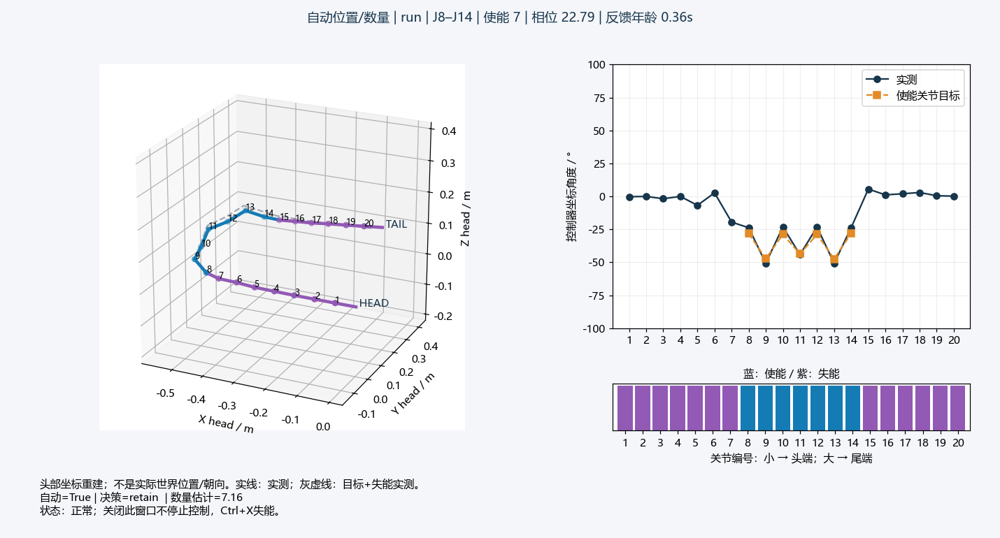

# 自主窗口同步与实测预览软件验证

用户授权同步既有v3研究控制，不增加新方法或动力学实验。固定实际记录/机械参数，只检查移植及适配。验收：同输入目标、掩码、事件一致；扩缩协议顺序正确；奇数宽度三模式切换连续；预览仅显示实际读角，不控制设备。

## 已执行

| 检查 | 结果 |
| --- | --- |
| 110→210→110修复记录，经实机与手调两个适配器 | 全6395控制帧；目标最大差1.11e−16 rad，掩码/事件一致，含扩7、缩6及六次后续移窗 |
| 110→210急弯记录，经两个适配器 | 全2098控制帧；目标最大差1.11e−16 rad，掩码/事件一致 |
| 内存串口扩窗/缩窗 | 扩窗先预置新ID后同步0x28；缩窗直接关退出ID；目标只包含主动ID |
| 七关节三模式切换、Ctrl操作 | 保留掩码/相位/目标，基础/固定参考按当前长度归一化；暂停、冻结、取消普通请求正确 |
| 预览数据与未接管读角 | 全20实测角；失能段不画零角目标；未接管不写目标或使能 |
| 仓库外复制单文件后启动独立预览进程 | 首帧实际绘制成功、进程正常关闭；没有真实串口连接或使能写入 |
| 原基础/固定顺应回归及MuJoCo静态接口 | 18项通过；未接管不推进物理、不将目标回显为实测 |

`checks.json` 保存4项新增测试结果及完整回放统计，`preview_process.json`保存单文件进程检查。显示布局调整和归一化参考峰值检查后又针对性复核相关软件测试，没有重跑动力学。



这是既有仿真角记录的显示效果，不是实机反馈截图。预览采用头部坐标，不读取根位姿/管道/接触。灰虚线是在实测失能段基础上替换主动目标角的构型对照，不是预测动力学。帧中的目标相位与角采样时刻可能相差一个读角间隔，按日志保留。

## 复盘与范围

迁移中处理了旧入口固定6关节断言，以及扩到7关节后切回基础会继续套统一幅值的问题。当前切换沿用相应长度的半圆参考；在使能前检查两个轴族的实际峰值和目标速度。预览初稿角度图标签与使能条标题重叠，已调整间距并重新渲染核对。

本轮没有新增MuJoCo动力学、连接真实机器人或注入真实系统热键。软件回放一致不代表实机通过；保留原实验218.67°短暂超限、急弯单轴不可测和仿真相位参考迁移假设。未测试任意显示设备、全量实机串口时序、所有速度和反向工况。下一步由用户手动仿真/实机测试，不追加自主实验。

```powershell
conda activate mujoco
python -X utf8 validation/test_posture_port.py
python -X utf8 validation/preview_port_smoke.py
```

以上是开发检查命令；日常只直接运行 `codes/Rolling_Arc_Real.py` 或 `codes/Rolling_Arc_Debug_Mujoco.py`。
