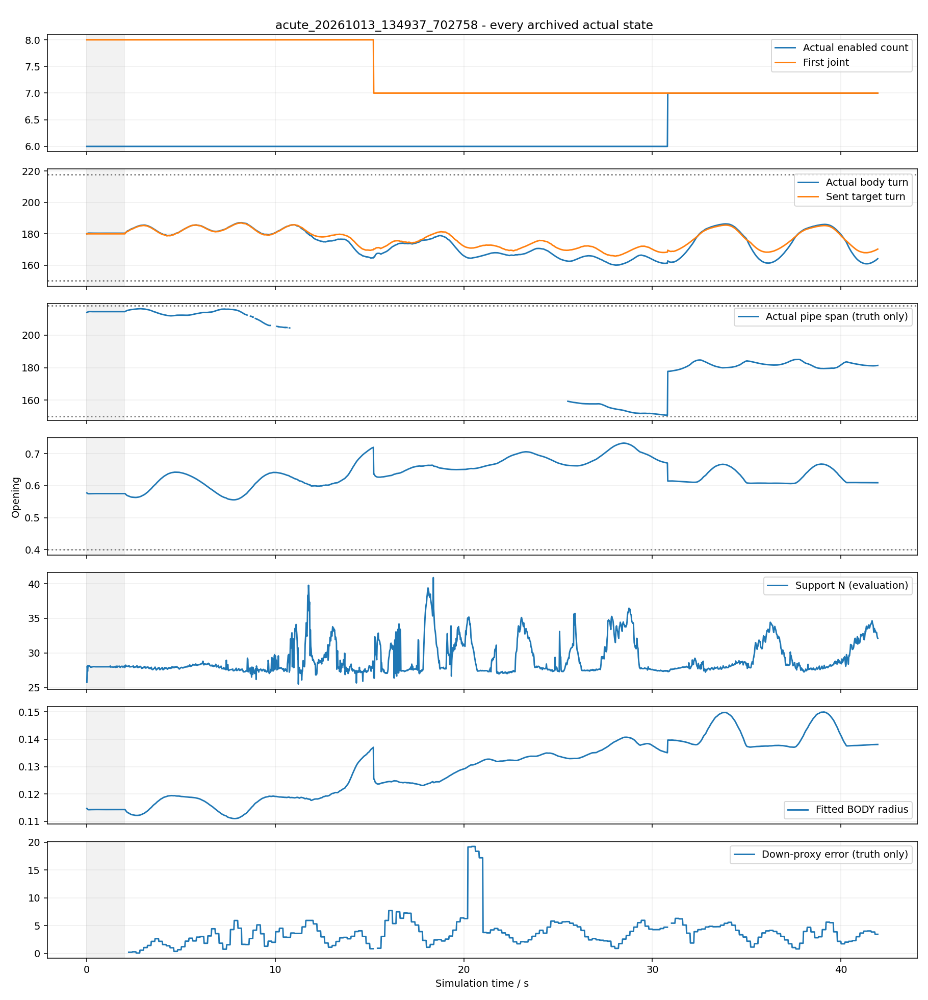

# 连续急弯变径主例复盘

本轮第2次动力学，沿用[冻结计划](../../../docs/姿态自主窗口实验计划.md)，没有修复重跑。实际41.96s、41960物理步、2099保存态；J8–J13、x=-.25m，连续90°实体弯、110/160/210mm，拐角前后各150mm变径。无外力，原阻尼、PD、限矩、200ms读角均不变。

## 已确认事实

15.2s J8–J13→J7–J12自动位置交接；30.8s J7–J12→J7–J13，真实使能由6变7。7不是等待补成8的过渡交易：此后保持11.16s，最后交接后1.06379指令周期；31.48s全身固定骨架越过特征，退出后继续1.00077周期。5s局部形态试探已结束，终态没有pending/trial/fault。指令相位累计误差≤1.22e−11rad，无正常hold。

位置交接进入J7实测17.032°、退出J13实测3.204°/−36.352°/s；进入新J13时实测−14.788°，共享预置跳变0、下一目标限速.9°。退出真实矩−.987Nm，不是卸载；扩展时没有退出关节。控制不读取这些矩或支持。

全部运动身体160.018–187.142°、开口≥.55578、平面RMS≤8.525mm，无目标形态违规；支持≥25.508N、失能主动矩0、有限、无落地/越限，饱和33833关节×1ms。局部投影曲率代理最小半径52.789mm，最差4.8s，不当作管径或实体杆件弯曲半径。

独立七关节实际段160.888–186.333°、开口≥.60645、RMS≤7.399mm；管轴有效值177.719–185.040°。55次新七关节角反馈覆盖24相位格，冠部代理相对于独立真重力的位置误差≤.22125关节；新宽度参考采用几何残差迁移，因此这只验证该病例，不能推成任意新宽度。全部6/7反馈199次、有可信长端，最高误差.35972关节，观察器4次建议无反向。

全身固定点均值位移[.24608,.46144,.06228]m；不因改变窗口重定义推进点。整个管轴有效区150.780–216.123°，无有效区违规，但764保存态单管轴不可定义可靠（含508接触轴冲突），严格整段管轴验收未通过。身体开放、支撑通过不能抹去该评价缺口。

## 问题、原因判断和下一最小工作

实际七关节选择后，36.0–41.8s新鲜数量代理6.6801–7.9058，仍有随相位变化的扩大建议；36.0–36.8s持续不足1s撤销，末尾41.2–41.8s也不足1s，因此没有创建8关节交易。终态selection='expand'但pending=None，是未完成持续确认的建议，不能称七关节长期最优或已经收敛，也不能称发生8关节扩窗。

可确认代理依赖实际/名义半径及转角；即使同相位归一化，身体与参考响应不同仍会使它随相位摆动，.5s过滤没有消除。这个机制解释置信度中等，尚未分离截面拟合、真实负载变形与相位滞后各自贡献。1s持续和形态门槛阻止本记录中的反复扩缩，但没有验证长期抖动不会发生。

本例没有触发缩窗、回退、8以上真实动力学或新策略双向往返。仅软件和名义全周期检查覆盖7/9，不冒充9关节真实支撑验证。没有固定6/8限制，但仍有明确机械/几何/可信参考条件。

下一最小工作先在现有55个七关节反馈上比较数量代理与相位、实际转角和圆拟合残差，判断是否需要跨相位的形状余量再决定进一步边界试探。无需重新跑相同病例或强制它变成9关节。本例满足本轮自主扩展、持续滚动、身体开放与支撑目标；不代表整个研究问题或任意自主长度选择完全解决。

