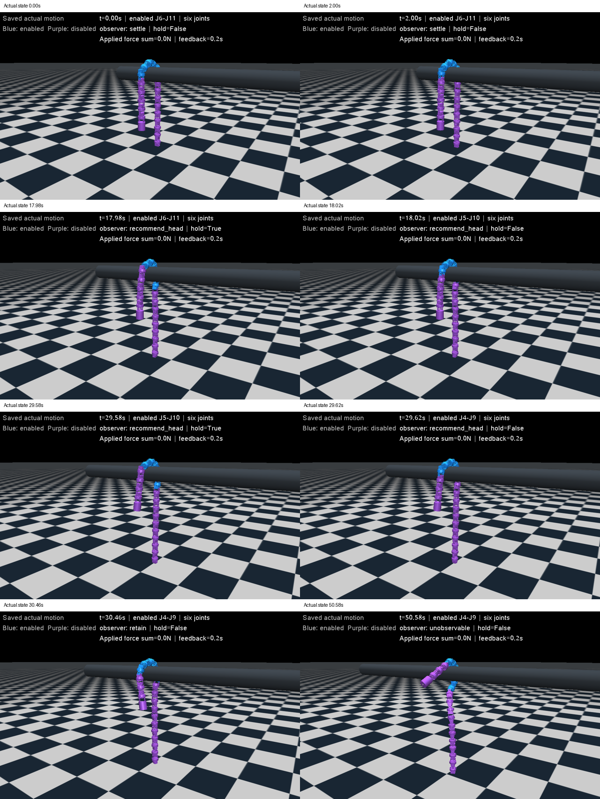
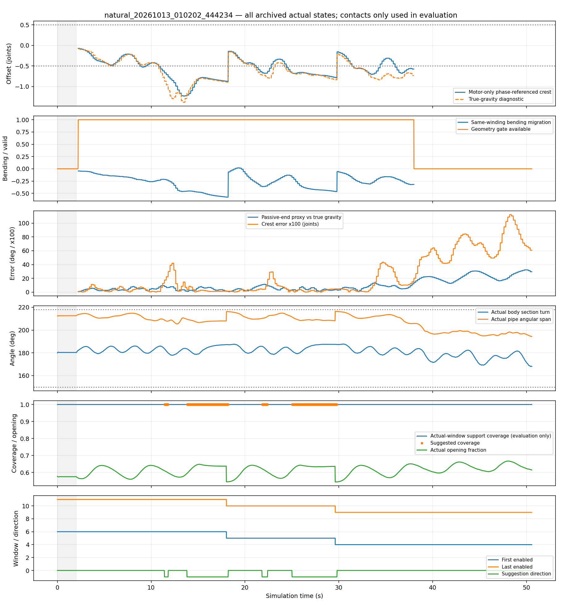

# 连续多次角度反馈移窗：2026-10-13

**同一段直管动力学中连续两次自动交接通过，已同步到现有仿真手调与实机单文件。**验证范围是J6–J11→J5–J10→J4–J9；往返未覆盖，真实机器人未连接。不能把本轮写成完整双向、任意端长或持续全相位跟踪已解决。

## 条件、数量与证据

开始前的假设、固定条件、验收和数量见[本轮计划](../../../docs/连续多次移窗验证计划.md)。先进行自然迁移1次，再进行返回激励1次；发现激励没有实际制造反向迁移后，用最后1次预算修正施力方向，控制阈值保持不变。总计3次新动力学，没有扫描强度、反馈延迟或阻尼。

实际场景由模型读取：水平连续直管直径113 mm，管轴X，中心z=1.2 m、x范围−1.2..1.8 m，摩擦2/.005/.002，重力−9.81 m/s²。20关节、21段64.5 mm，初始J6–J11，x=−0.9 m；已经名义搭管后静置2 s。幅值60°、频率0.6 rad/s、顺应增益.02、yielding .7、目标过滤.15 s；PD127/1、限矩2.355 N·m。失能关节主动驱动力矩为0，机械阻尼1.5及armature .01仍存在，未标定为实机等效阻力。

**控制器只收全20关节实际角、采样时刻、已知指令相位。**本轮新角反馈200 ms，目标更新20 ms，物理步1 ms。速度由连续新读角差分；重复样本不增加确认时间、不完成交接。接触、世界姿态、真重力、实际力矩、扰动阶段全部仅存档/评价，不送入选窗。

| 动力学记录 | 完整时间 | 自动窗口链 | 判定 |
| --- | ---: | --- | --- |
| [自然例](natural_20261013_010202_444234/status.json) | 50.58 s | 6–11→5–10→4–9 | 连续两次通过；最后交接后2.002个指令周期 |
| [头端斜拉](return_20261013_010758_431294/status.json) | 82 s | 同上，无返回 | 没有符合判据的实际反向迁移，返回未覆盖 |
| [竖直载荷差复验](return_repair_20261013_012403_696880/status.json) | 82 s | 同上，无返回 | 局部向尾侧回摆，但未达到实际迁移判据，返回仍未覆盖 |

每例`actual_trace.jsonl.gz`保存全部20 ms实际qpos/qvel、目标、掩码、角度输入、事件、评价接触/力矩和外力；`status.json`保存实际条件和1 ms统计。`evaluation.jsonl.gz`、`review.json`、`full_timeline.png`与`actual_montage.png`用于全程审查。失败原始记录及未通过的返回review保留。

## 自然例全程复盘

18.0 s：J6–J11→J5–J10；29.6 s：J5–J10→J4–J9。没有手动请求窗口、没有重置位姿、没有外力。两次观察建议、真重力冠部偏移（−.893、−.837关节）和同旋向弯曲迁移一致；候选窗口接触支持覆盖均1.0。使能始终6，其余主动矩始终0。

交接先等待退出关节所在奇偶族的名义零相位，再保持相位，直到新读角确认进入/退出关节角≤4°、差分速度≤8°/s、候选实际与预置目标均开放。两次保持2.92、3.76 s，**不是无停顿切换**。进入角分别3.456°、−3.586°，退出角.366°、−.904°；退出主动矩评价值.000573、.054798 N·m。小角/低速只是几何交接条件，不能从它们证明实机已卸载。

审查全部2530个保存态和50580个物理步，包括交接前后、最差形态、最后两个周期：

| 指标 | 实际结果 | 验收 |
| --- | --- | --- |
| 身体截面转角 | 168.08–187.76° | 150–218° |
| 开口比（端距/主动骨架长度） | 最低.54438 | ≥.4 |
| 平面拟合RMS | 最高8.533 mm | ≤15 mm |
| 实际管轴角跨度 | 194.41–216.41° | 本例≤218° |
| 最小平滑曲线半径 | 51.493 mm | 全程记录；无逐渐收紧趋势 |
| 窗口支持覆盖/向上支持力 | 最低1.0 / 26.288 N | 覆盖≥.8，支撑仅评价 |
| 主动矩/使能/失能 | 峰值2.355 N·m / 始终6 / 失能主动矩0 | 掩码与失能通过 |
| 地面接触/限位越界/非有限值 | 均0 | 通过 |

饱和累计1444个“关节×1 ms步”，不是1444 ms整机饱和，也不是无饱和。身体质心推进约.797 m，侧向净漂移−31 mm。没有同条件关闭滑窗对照，不能声称效率或通过率改善，也不能仅以承重证明移窗必要性。

**发现的问题：观察不是全程可用。**滚动保存帧中的有效比例73.69%，共629个20 ms帧由于两端向下方向不一致拒绝判断。共253次独立新采样（滚动阶段243次），510个“建议帧”包含保持读数，不能称为510次独立观测。第二次移到J4–J9后只有3个头侧被动关节，继续头向移窗本来就受当前最短端限制；后段头侧失能段明显偏离竖直，观察器转为不可观测，身体仍开放且在管道上持续运动。

已确认：失能主动矩0仍不保证悬垂端在所有时刻自由竖直。管道接触、被动机械阻力和运动可以约束末端。造成观察退化的具体动力学贡献尚未逐项分离；认为头侧失能段不再可靠代表重力方向是高置信判断，不能将所有原因归为外部拉力。本例无外力。





## 返回激励的失败与原因

第一种36–39 s施力：头端向外/向下总20 N。真实冠部在脉冲阶段偏移始终为负（−.925..−.506关节）；松手39–50 s中位−1.213，支持中心也继续向头侧移动。逐新反馈，真重力冠部和同旋向弯曲共同达到尾向阈值的样本为0。因此不能把没有返回说成“窗口没有跟上已经发生的反向迁移”。

机械复盘发现关于真实X管轴的外力矩方向与期望一致，但水平/竖直分量抵消较大；实际脉冲中位约.521 N·m。同姿态纯竖直载荷差约3.655 N·m，是修正前机械估算，不是已经执行的结果。

最后一次36–39 s用头端向下17.071 N、固定J10模块向上2.929 N：两力大小之和仍20 N、净向下仍14.142 N，不改控制判据。真实冠部脉冲期回摆至−.796..−.220关节，中位−.309，但未过+.5；同旋向弯曲中位−.106，松手后又回到头侧。共同尾向样本仍0。实际没有返回，**复验未完成返回验收**；3次预算用完后停止增加测试。

两例均检查全部4101保存态与82000物理步：身体开放、管轴跨度、6关节/失能、支撑、限位、有限值及无落地通过；后段观察退化仍存在。饱和分别773、691关节步，峰值仍2.355 N·m。详细阶段诊断保存在各自`cause_audit.json`；实际总外力矩包含所有施力body，不以刚体转动估算代替真实冠部迁移。

## 同步范围和操作

用户要求的连续两次自动移窗主目标通过；额外返回病例没有制造符合当前判据的反向迁移，不能扩大结论。[sync_review.json](sync_review.json)明确本次同步范围；原返回review仍为false。没有降低被动端门槛或移窗阈值来取得通过。

现有两个入口共用`RollingArcController.tick_motor_sliding`及单文件内角度核心；实机文件顶部保留可读参数与Ctrl键位，冻结相位基准也嵌入该文件，运行时无需相邻模块或JSON。只需已有`mujoco`环境直接运行：

```powershell
python codes/Rolling_Arc_Debug_Mujoco.py
# 或真实机器人（本轮没有执行）
python codes/Rolling_Arc_Real.py
```

Ctrl+U形成→静置完成→Ctrl+3自动滑窗→Ctrl+G滚动；Ctrl+1基础、Ctrl+2固定、Ctrl+W取消/恢复自动请求（关闭时取消等待中的交接）、Ctrl+空格暂停相位、Ctrl+N冻结目标、Ctrl+X全部失能。默认仍基础圆弧/J8–J13，不自动开扭矩。滑窗基准限定60°/.6/正向；返回实验中的“尾向交接”与反向滚动指令是不同概念，后者没有标定，滑动模式拒绝Ctrl+H/T。

交接串口只预置进入舵机的实测角，随后同步0x28写新6关节掩码并逐ID读回；位置包仅发送使能ID。固定/基础模式保留移窗后的当前窗口。无效实际形态保持最近目标和旧掩码，需重新选模式；角反馈过期/通信异常终止并尝试全失能。

同步验证采用所有3份实际角输入的10729个控制帧重放：实验模块、实机核心/适配器目标最大差1.11e−16 rad，相位/掩码/交接事件一致；自然例仿真适配器同样一致，50.58 s只有253次新角采集。内存串口验证预置→扭矩交接顺序及只发使能ID，检查Ctrl映射、暂停/冻结、取消交接、形态拒绝和模式切换。另复跑23项已有相关软件检查；共26项通过，**全部没有新动力学或真实设备连接**。[port_checks.json](port_checks.json)保存详细结果。旧6200帧角度记录的前置复现也通过，见[prior_core_replay.json](prior_core_replay.json)。

本轮未验证：真实串口采集耗时和量化、失能编码器有效性、真实重力/阻力、尾向交接与往返、少于3段被动端、弯管/变径新版本回归。当前不追加；若下一轮继续研究双向，最小验证应先离线规划能在有效观察条件下真正制造尾向冠部迁移的激励，再只跑1个物理病例。不能继续重复本轮未成功制造反向输入的拉动。

完整实际运动视频保存在本机`validation/results/repeated_motor_sliding/`，分别为上述三个目录名的MP4；10 fps覆盖全部保存时间，生成时仅`mj_forward`回放，没有动力学重跑。帧图包含两次交接前后、刺激前中后、最差状态和终态。视频不入Git，全部实际输入/状态及回放脚本入Git。本轮只本地commit、不上传GitHub。
