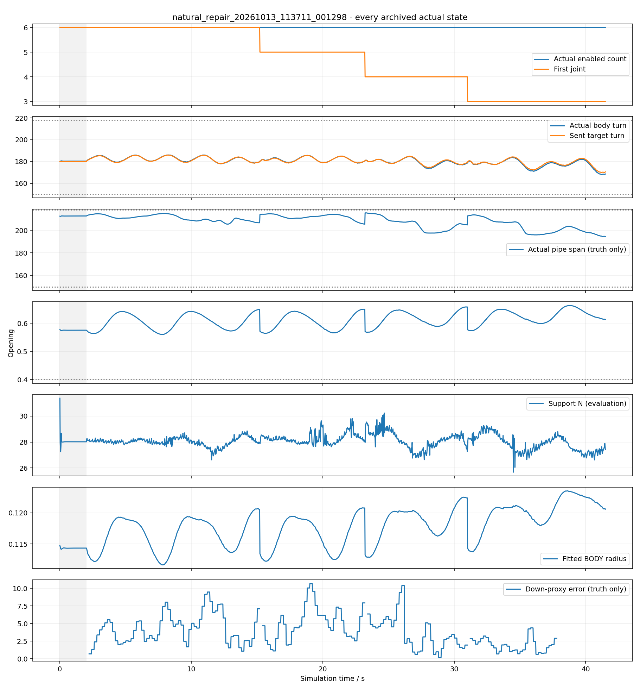
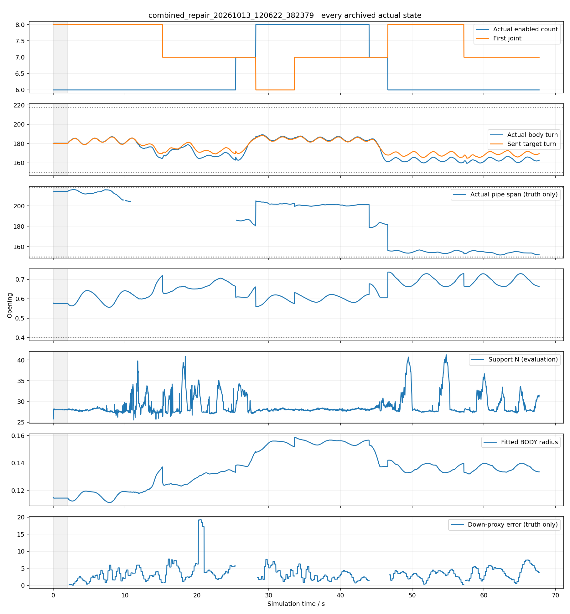

# 连续滚动交接：2026-10-13实验复盘

**固定六关节直管三次无停顿自动移窗通过；急弯内完成实际头向→尾向→头向返回及6→7→8→7→6，持续相位、身体开放和支撑检查通过。本轮没有完成所有新增范围：固定六关节强载荷返回失败；短端无可信悬垂参考时的全相位可靠定位未解决；急弯严格单管轴评价有不可测区。现有实机/手调不更新。**

开发前的假设、变量、条件和数量见[冻结计划](../../../docs/连续滚动交接实验计划.md)。原3主例+1修复上限4；真实急弯暴露动态采样统计缺陷，运行前明确增加仅1个同病例修复，最终5次。没有扫刺激强度、延迟、阻尼或另跑旧基线。[设计与代码位置](../../../docs/连续滚动交接设计.md)说明输入、条件和修改位置。

## 条件和真实场景

已有Conda mujoco，20关节/21×64.5mm，名义奇偶族各π、正向0.6rad/s、200ms新全角、20ms目标、1ms物理；K=.02/yielding=.7/目标过滤.15s，PD127/1、限矩2.355Nm、阻尼1.5、armature.01和摩擦不变。失能主动矩0，机械阻力仍存在，未标定成实机等效。

控制只读角、时间、已发相位/掩码和机械长度。没有root姿态、真重力、qvel、接触、管径、实际Nm矩或刺激标签输入；qvel只供仿真内层PD。初始已按名义圆弧搭管，静置2s，不是任意摆放自搭管。

直管实际直径113mm、X轴、z=1.2m、x=-1.2..1.8m；短端复制同圆柱只延长出口至3.8m，数值路线同步。急弯实体连续+x→+y、90°，入口110/拐角160/出口210mm，变径跨拐角前后各150mm，没有断口。

## 五次实际运行

| 记录 | 完整时间 | 实际行为 | 结论 |
| --- | ---: | --- | --- |
| [纯弯曲首例](natural_20261013_112105_172339/review.json) | 82s | J6–J11不变 | 身体/支撑通过，但漏判实际冠部迁移，保留失败 |
| [组合定位修复](natural_repair_20261013_113711_001298/review.json) | 41.50s | J6–J11→J5–J10→J4–J9→J3–J8 | 三次连续自动六关节交接通过，最后后续1.001周期；覆盖两关节短端 |
| [短端返回载荷](short_return_20261013_114112_437283/review.json) | 120s | J3–J8→J2–J7；落地后才“返回” | 无载时一关节短端成立；强载荷返回失败，不能算管上往返 |
| [急弯原实现](combined_20261013_115002_906774/review.json) | 150s | 扩缩及三次位置交接发生，57.2s后停止相位 | 身体和支撑合格；试探漏采样误报失败，整例未通过 |
| [急弯计数修复](combined_repair_20261013_120622_382379/review.json) | 67.70s | 同样扩缩及头→尾→头往返，相位持续推进 | 本轮动态交接/身体/支撑通过；整体研究范围仍未全部验收 |

每例全部20ms实际qpos/qvel、目标、使能、输入、反馈时刻、控制状态/事件、接触/矩留存；1ms统计保存在status，原失败没有裁剪。最初一次尾body名字初始化错误发生0物理步，单独记录，不当成动力学尝试。旧版本源码在intrinsic_only_version及before_trial_fix，记录对应版本可重放。

## 直管三次连续移窗

15.2/23.2/31.0s实际交接，始终六关节使能，其余主动矩0；没有侧拉、手动请求、根位姿重设或正常hold。冠部独立迁移残差−.797/−.875/−1.203关节，候选支持覆盖均100%。退出实际矩约−.651/+.658/+.648Nm，**不是已确认卸载**。例中进入关节曾17.346°，退出角3.116°、速度−37.394°/s；实测预置让它无需先静止，实际后续仍保持开放。

实际身体168.09–186.02°，开口≥.5602，RMS≤8.502mm；真实管轴194.52–215.38°，最低支持25.673N；无落地/越限/非有限，饱和796关节×1ms步。推进量.763m，原暂停版本有不同窗口链/时长，不能由此声称通过率或能效优势。

## 短端与返回失败

短端例7.4s从J3–J8实际移到J2–J7，方向与真冠部−.949关节一致、候选支持覆盖1.0，随后在无载期持续运动。2–24s身体169.02–184.32°、开口≥.5735、RMS≤8.416mm、管轴191.34–213.98°、最低支持25.797N。证明本模型下一关节头侧被动端可通过长尾端条件代理接管；不证明所有短端摆放。

24–36s头向下/尾向上各30N（2s余弦渐入出），60–72s反向，净外力0、峰值大小总和60N。这是比旧未制造反向输入的20N脉冲更明确的载荷差，但25.72s已首次支持<2N，26.32s保存态出现地面接触。38.8s掩码回到J3–J8发生在落地之后，候选管道支持0、真冠部方向也不符；38.86s才记录目标约束故障。因此返回失败不能归为“管上运动交接卡住”，也不能将返回索引当成真实管上跟踪成功。

失能矩仍0，状态有限，但地面接触93639物理步、饱和36516关节步，整个例body/pass/mechanics均失败。强端部载荷破坏支持是时间关系确认的事实；载荷、短端杠杆/支撑余量和限矩各占多少未分离，原因置信度中等。没有为了成功降低强度再重试。后半落地数据保留，但不作为正常管道定位验证；新实验驱动已加落地/故障结束，未另跑动力学验证新停止规则。

## 急弯复验与双向范围

15.2s J8–J13→J7–J12；25.4/28.2s扩为J6–J13；33.6s八关节向尾侧移到J7–J14；44.0/46.6s缩为J8–J13；57.2s六关节向头回到J7–J12。实际窗口中心10.5→9.5→10.5→9.5，三次位置交接真冠部−.591/+.680/−.766关节，接触支持均保持。因此**组合扩缩情况下的管上双向返回已经观测到**，不能扩大为固定六关节强载荷往返也通过。

退出矩−.987/+.393/−.806Nm；候选支持覆盖1.0/1.0/.7505，不满足“每次都覆盖80%或全承重”的说法。全程窗口含边界支持覆盖最低.0608；有被动段支撑，当前不能精确识别并使能全部受力关节。

复验身体159.46–189.15°、开口≥.5558、RMS≤8.525mm，最低支持25.508N；失能0，无落地/越限/非有限，饱和50372关节步。相位最大累计误差2.3e−11rad，正常交接无phase_hold；七关节仅交易中5.4s，无孤立稳定7。最后交接后1.001指令周期（按交接事件实际发出相位计，不能多算此前20ms），连续全身退出3.138周期。真实管轴有效区151.82–216.12°，无有效区违规，但764滚动保存态不可定义可靠单轴（含508接触轴冲突），严格管轴验收仍未通过。

原停止是实现缺陷：57.2s旧trial.good=true/28samples，实际截面161.102°合格；pending中仍滚动却漏计样本。修复等待阶段计数、移窗后重启周期，数量不足继续收集。原57.2s前2861控制输入回放目标/相位/掩码0差，修复不再误报；之后用新动力学复验，不能用旧停机角度证明新响应。[原失败与修复计划](combined_repair_plan.md)保留。

复验最后新窗口已有53次合格角反馈，但最后新角的相位尚未越过一周期门槛，终止时six_trial仍在等待、prefer_feasible_six=false；实际20ms保存态已覆盖一周期。不能写成控制器完成了新的六关节偏好确认。驱动已改为等确认再结束，未为约0.1s重跑整例。此状态不否定实际扩缩/往返与全过程形态，但该确认出口仍未覆盖。

## 全相位采样与真实定位分开

纯弯曲首例399新反馈全部能输出，但353次实际冠部头向偏移没建议，误差最高1.055关节；强弯曲117个既有建议正确也不能证明召回所有迁移。组合定位保留可信冠部并以弯曲交叉确认，没有靠调低阈值取得结果。

直管修复197新反馈：两端一致120次、单长尾58次，位置偏移误差分别≤.440/.156关节；另外19次无可信端，弯曲代理与冠部误差最高1.846，不能算全相位可靠冠部定位。这19次没有移窗建议，没有虚构方向观测。47次实际建议全部同方向。

急弯复验稳定6/8阶段301次新反馈，24相位格均覆盖，条件性冠部偏移误差≤.360关节；39次建议38次达到独立0.5关节位移尺度，剩下一次同方向但较弱，无反向误建议。三次实际位置交接均正确。该病例具备可信被动参考，支持此条件下全相位定位；**不代表短端盲区、被强拉的末端、7关节过渡或任意绝对姿态也可定位**。曲率质心不是最高点；关节角本身不包含全体绝对朝向。

## 交付与下一最小工作

主要成果：研究仿真中的连续相位交接、三次固定六关节移窗、一至二关节短端接管、组合扩缩的双向返回；条件满足的急弯病例覆盖全相位。未完成：固定六关节强载荷返回、短端无可信向下参考区、7关节相位定位、严格急弯单管轴与六关节偏好确认出口、任意初态、其他速度/方向及真实设备。没有声明整项Step2全部通过。

全部实际输入按对应历史版本重放23060控制帧，目标/相位最大差0、掩码与命令事件序列一致；2项新针对性软件检查通过，没有新物理或硬件。`summary.json`与`input_replay.json`给出机器可读结论；局部投影曲率/拟合身体半径全量审查在summary，不当作真实管径或实体杆件弯曲半径。

下一项最小工作先用已保存的19个不可信端样本核对拒绝原因和可观测性；然后设计不会先使机器人脱管的固定六关节返回激励。不能在落地轨迹上调观察器证明管道控制通过，也不以更低阻尼/更理想反馈制造成功。本轮5次结束，不追加。

当前单文件实机和手调仍是之前的固定六关节暂停交接方法；本轮无串口、机器人、真实热键或能耗实验。只本地commit，不上传。视频位于本机`validation/results/rolling_handover/<记录名>.mp4`，完整覆盖初态到终态，10fps，mj_forward回放，无动力学重跑。HUD区分handover hold与fault/相位，防止把异常停机称为正常hold。成功和失败的参数、状态、分镜、完整时序图及源码入Git，视频不入Git。
