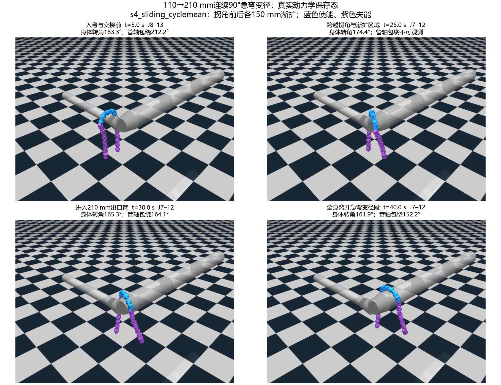

# 实际截面顺应与滑动窗口：仿真实验复盘（2026-10-12）

已完成本轮仿真开发和声明的17次动力学运行。最终使用**固定6关节、一个半圆曲率预算、按整周期承重定位、卸载相位交接**；窗口外主动驱动力矩为零。110→210 mm连续90°急弯已完成全身通过及出口后3个有效控制相位周期，未观察到累计收紧。本轮不是全部指标通过：急弯管轴覆盖/可观测性、4 N载荷触发迁移仍有下面列出的未通过项。

本轮仅本地Git记录，实机程序和研究路线原文未修改。最终定位器只新跑急弯修复和载荷回归2例；前面其余案例验证的是相同截面/交接核心配短时滤波定位器，不能写成最终定位器已重跑全部场景。

**观测与措辞澄清：**“有效控制相位周期”是内部滚动指令φ推进2π、排除停相位，未测量机器人绕管道的真实转角。窗口选择使用MuJoCo连杆接触力，交接使用主动关节矩；仅电机可读反馈的自动滑窗尚未验证。截面在机器人自身坐标系拟合，未控制其相对地面的绝对朝向。此澄清不改变已保存的实际状态、指标数值、判据或实验次数；运动/开放结论仍来自实际状态审核。[具体边界](../../../docs/滑动窗口截面顺应设计.md)



[最终急弯全程侧/端视视频](s4_sliding_cyclemean_full.mp4) · [完整指标](s4_sliding_cyclemean_review.png) · [最差状态](s4_sliding_cyclemean_worst.png) · [全部17次结果总表](结果总表.md) · [方法与常改参数](../../../docs/滑动窗口截面顺应设计.md)

## 条件、数据和审查范围

20关节；初始圆弧J8–13、幅值60°、ω=0.6 rad/s；kp=127、kd=1、主动限矩2.355 N·m，失能关节保留模型机械阻尼1.5。2 s形成已搭管初态，随后控制器从实际q和承重取得窗口，不读取形成阶段窗口。三种初始搭管范围检验接管，不是从任意悬空姿态自行搭管。

实际截面：q→正运动学→局部平面→连续线圆弧→Yamada积分，K=0.02、yielding=0.7，过滤0.15 s、速率45°/s、几何反馈20 Hz。保持前轮半圆参考校准和去D规则方案；不是把2023螺旋包绕算法原样用于半圆。

定位器读取每个物理连杆的真实管道接触力世界竖直正分量；交接读取实际主动关节力矩。截面反馈不读取接触、管径或路线。管道中心线、半径和全身进度只用于初始化/评价；控制过程中没有改根部位姿来牵引机器人，没有在急弯做步态切换。

每次运行保存全程qpos/qvel、实际发送目标、使能/权重、支持力、选择原因、几何重建和事件。动力学步长1 ms；限矩、失能输出与限位逐物理步检查；过滤后命令开放约束每20 ms审查；身体/管轴/承重等全程每100 ms保存并审核。视觉复盘覆盖从搭管到结束的每2 s侧/端视序列、交接事件及最差状态；完整10 fps实际状态回放视频也保留。没有把一张末态截图当作全程通过证据，也不声称人工逐帧看过每个视频帧。

冻结门槛：实际身体截面150–218°、端距/主动骨架长度≥0.4、平面拟合RMS≤15 mm；过滤后发送截面≤190°、开口≥0.4；管轴包绕可观测时150–218°；连续承重不足2 N少于0.5 s；无地面支撑、主动限矩/关节限位合格。身体形态与管轴覆盖是两个判据。出口后观察按有效控制相位≥6π，不包含交接停相位。

## 测试数量与逐轮复盘

初始11次：S1交接2、S2选窗3、S3应用3、S4大变径对照3。增加6次有原因的修复/回归：S1交接修复3、出口周期计时修复1、周期承重定位修复/回归2，总17次。各次增加均先记入[冻结计划及修复记录](../../../docs/滑动窗口实验计划.md)。没有延迟、低阻尼、随机扰动和统计重复实验；渲染/审核保存态不计为新动力学运行。

### S1：相邻迁移，5次（含3次失败）

原平滑6→7→6策略`s1_head`完成两次交接、承重保持，但发送峰值196.56°、管轴包绕242.10°，失败。先把旧圆弧预算180°降到150°后再接入进入关节的`s1_head_repair`把发送峰值压到187.49°，实际身体153.15–190.20°，仍因7关节并集管轴227.14°失败。这说明目标约束与身体开放不足以证明整个并集符合管轴覆盖。

临时6→5→6的`s1_head_contract`全程承重，但实际身体最低142.90°、管轴最高227.01°，失败并存档。两个同类关节在5关节段需75°幅值，其峰值名义速度75×0.6=45°/s占满命令速率，可能造成跟踪不足；这是合理解释，尚未证明唯一原因。没有继续堆叠阈值调整。

最终利用相邻移窗的进入/退出关节同奇偶族：等待其sin/cos接近零，暂冻结滚动相位而物理/顺应继续，进入/退出实际角≤4°、速度≤8°/s、退出主动矩≤0.2 N·m且新窗支撑/形态合格才原子切换6→6。重叠5关节保留过滤目标，进入关节预置实际角，其余关节失能，随后恢复相位。

`s1_head_phase`、`s1_tail`分别两次完成头/尾及返回交接，全部门槛通过；任一时刻6关节使能、外部力矩0，最后交接后3周期未收紧。身体峰值分别187.83°、187.65°。这验证交接可行，代价是等待卸载相位和实际卸载，有停顿，不能称无停顿滑移。早期失败完整曲线、截图和原始状态保留；历史策略代码在739e9f3中可追溯，当前不是默认策略。

### S2：自动取得窗口，初始3次＋最终载荷回归1次

前/中/后支撑初态分别由J4–9、J8–13、J12–17形成，控制器均在2.031 s自行取得对应实际承重圆弧。早期定位器下前部向头完成2次相邻迁移，中部1次，后部保持原窗；运动与开放指标通过。保持后部原窗是允许的，不强制所有形态都移动。

中部在14–24 s向link14施加实际4 N向下载荷（首尾1 s平滑），不是向选择器注入伪造的接触数组。旧`s2_middle_payload`移窗在28.181 s申请、31.850 s完成，发生在载荷撤除之后；仅有该轨迹不能证明迁移由载荷引起，不能写成快速载荷跟随或因果对照。

最终`s2_middle_cyclemean`在同一4 N物理载荷条件运行90 s，所有承重、目标、身体及管轴指标合格，但没有自动迁移。整周期承重中心全程9.425–10.395，相对J8–13中点10.5的最大偏移1.075，小于冻结1.25门槛；加载阶段中心9.921–10.345，当前窗覆盖滤波承重100%。因此“该4 N短时载荷必然要求移窗”的测试前提没有成立，保持窗口与当前判据一致。

原预设`automatic_migration_observed`仍为false，完整判定保留失败/未覆盖，没有调低阈值改判。最终方法的真实自动迁移由S4提供。若后续专门研究载荷驱动迁移，应一次性设计使平均承重点越过边界的实际载荷位置/持续条件，或先明确快速响应目标；本轮不追加试调载荷矩阵。

### S3：应用3次＋观察计时修复1次

| 场景与保存记录 | 全身出口 s | 出口后有效控制相位周期 | 身体转角范围 ° | 结果 |
| --- | ---: | ---: | --- | --- |
| [113→163 mm直管](s3_taper.json) | 27.3 | 3.008 | 179.99–186.91 | 完整通过 |
| [90°柔弯内113→163 mm渐扩，原记录](s3_taper90.json) | 39.3 | 2.746 | 177.27–187.20 | 运动/形态合格，出口观察不足，保留失败 |
| [同病例计时修复](s3_taper90_cycles.json) | 39.3 | 3.004 | 177.27–187.20 | 完整通过，1次自动交接 |
| [113 mm连续90°急弯](s3_elbow90.json) | 29.8 | 3.008 | 164.88–187.44 | 运动和身体开放通过；106采样单管轴不可观测，完整未验收 |

计时问题是旧程序用出口后的仿真秒数除名义周期，误把柔弯交接的3.416 s停相位计入。修复仅延长终止观察，原运行保留且更正判定。新旧共有710个采样qpos/qvel差为0，详见[计时修复前缀记录](s3_timer_fix_prefix.json)。其余两例有效控制相位已达3周期，不重复。

柔弯修复出口后三个周期身体峰值186.132°、185.827°、185.797°；无出口后累积收紧。急弯跨两段管轴时单截面指标不能唯一代表管道，身体开放不能替代“管轴已验收”。这一边界进入S4仍保留，不因视频看起来能通过而抹掉。

### S4：110→210 mm连续90°急弯，3对照＋1修复

新几何从+x直接转向+y，中心线90°、无圆角；实心圆台在拐角相交，实体连续，没有断口。入口直径110 mm，拐角160 mm，出口210 mm，渐扩集中在拐角前后各150 mm。16段实体、每环48顶点，元数据见[场景说明](../../../mujoco_model/sliding_section_scene_manifest.json)。入口/出口径差100 mm，半径差50 mm；三对照使用相同模型、初态、摩擦、增益和限矩。

| 同初态对照 | 全身出口 s | 总时长 s | 身体转角 ° | 开口最小比 | 完成交接 | 管轴越界/不可观测采样 | 机械正功 J / 饱和 s |
| --- | ---: | ---: | --- | ---: | ---: | --- | --- |
| [基础步态](s4_baseline.json) | 32.6 | 64.1 | 161.43–180.36 | 0.575 | 0 | 9 / 45 | 144.22 / 51.82 |
| [固定窗截面顺应](s4_fixed.json) | 32.9 | 64.4 | 160.38–186.97 | 0.554 | 0 | 13 / 46 | 142.02 / 51.99 |
| [滑动窗，旧短时定位](s4_sliding.json) | 45.7 | 87.3 | 159.01–187.20 | 0.547 | 4 | 7 / 35 | 149.28 / 69.15 |
| [滑动窗，最终整周期定位](s4_sliding_cyclemean.json) | 38.0 | 69.5 | 160.93–186.97 | 0.554 | 1 | 18 / 47 | 144.38 / 54.75 |

四次均完成出口后至少3个有效控制相位周期，未失去支撑、无地面支撑，身体平面拟合最大8.44 mm、使能窗外主动矩严格0。身体与运动通过，全部完整判定仍为false：拐角有单管轴不可观测帧以及**可观测帧包绕<150°**。不是只有不可观测问题。最终最小管轴包绕142.84°（20.5 s），18个越界采样约1.8 s、47个不可观测采样约4.7 s。冻结阈值不改变，也没有把这些帧偷偷排除。

最低覆盖发生于接近直角交汇处。身体约半圆不等于相对指定管轴包绕半圆；实体交汇处截面也不再是单一圆。定位/身体平面姿态与单管轴评价的适用性均可能贡献，尚不能把全部越界断言为评价器错误，也不能据此断言6关节长度必然不足。最低值、完整时程和[最差状态](s4_sliding_cyclemean_worst.png)一起保留。

旧定位器把周期内接触摆动当成持久偏移，初次J8–13→J7–12后，出口后又J7–12→J6–11→J7–12→J6–11，共停相位约19.77 s。最近一个有效控制相位周期积分F·dφ取承重中心，停相位不累加，交接清除旧分布，再保留1.25关节死区/1.2 s持续/5 s冷却；这是针对已知问题的单项修复。

最终在19.681 s申请、20.301 s停相位、24.370 s完成J8–13→J7–12；进入/退出角约−0.94°/−4.00°，退出主动矩0.0794 N·m，覆盖99.994%。出口后的3周期没有再申请迁移，身体峰值166.182°、166.124°、166.320°，管轴峰值155.958°、156.059°、155.875°。观察内无逐周期收紧；仅3周期不足以证明任意长时稳定。

整周期定位避免了本例往返，较旧滑动版本提前17.8 s完成观察，但仍慢于基础/固定版本，不能宣称效率提升或通过率优势。机械正功不是电能。大管径四例均长时间触及2.355 N·m主动限矩，最终饱和54.75 s；限矩合格不代表驱动裕量充分。

## 为什么没有保留扩窗作为最终方案

6关节机械骨架约387 mm，贴近210 mm管外理想半圆骨架估算约421 mm，理论上提示精确180°覆盖可能不足；它不是直接判定失败的证据。实际固定6关节保持承重和开放，大管出口稳定在约165°身体转角，原冻结允许150–218°。因此没有触发按管径永久加窗；保持每个奇偶族总π预算，防止添加关节却维持60°幅值造成额外包绕。

已按授权尝试过临时6→5→6，它在S1失败，未作为最终方法。当前不能以“承重通过”宣称任何急弯均达到严格半圆管轴覆盖；若研究目标改为大管全程更接近180°，应先区分交汇几何/姿态与弧长不足，再设计扩缩，避免为上述未确认原因盲目加关节。

## 复现与文件

在仓库根目录使用本机Python 3.12和MuJoCo 3.3.0：

```powershell
# 交互入口：空格保持/恢复相位；A/D向头/尾请求；U自动定位开关；R反向
py -3.12 -X utf8 codes/Rolling_Arc_Sliding_Section_Mujoco.py --scene elbow90_taper110_210 --start-x -.25 --duration 150
# 单次最终实验；另设目录/label避免覆盖归档数据
py -3.12 -X utf8 validation/sliding_section_experiment.py --scene elbow90_taper110_210 --label my_sliding --start -.25 --duration 150 --exit-cycles 3 --output validation/results/my_sliding
# 同初态基础/固定对照：同上条件，仅替换mode和label
# --mode baseline / --mode fixed
# 仿真实际外载荷：最长90 s，明确检查是否发生自动迁移
py -3.12 -X utf8 validation/sliding_section_experiment.py --scene straight --label my_payload --initial-window 8:13 --payload --duration 90 --output validation/results/my_payload
# 仅保存态审核、渲染和总表；不增加动力学实验
py -3.12 -X utf8 validation/audit_sliding_section.py --labels s4_sliding_cyclemean s2_middle_cyclemean
py -3.12 -X utf8 validation/render_sliding_section.py --labels s4_sliding_cyclemean s2_middle_cyclemean --video
py -3.12 -X utf8 validation/render_sliding_overview.py
py -3.12 -X utf8 validation/summarize_sliding_section.py
# 必要静态检查：独立FK、相位、卸载门、整周期积分与停相位
py -3.12 -X utf8 validation/check_sliding_section.py
```

`*_trace.npz`保存完整实际状态/命令/掩码/力，`*_records.json(.gz)`保存几何和原因，`*.json`保存参数和判定，`*_audit.json`逐采样审核，`*_review.png`时程，`*_filmstrip*.png`全程时序侧/端视。MP4就在本目录，Git忽略视频但保存全部可重渲染状态、脚本和PNG，没有依赖新动力学运行生成视频。

必要静态检查通过：完整名义交接并集FK样本最大180°、开口最小0.515079；卸载主动矩不足时不换窗、卸载后6→6且命令连续；周期性接触积分中心不随停相位偏移。GUI热键没有人工实测，不能当作键盘可用性验收。最终自动定位没有重跑全部前/中/后与S3场景；实机接触力/力矩观测与部署性能仍未验证，用户验收前不移植。

本轮达到仿真原型、相邻交接、真实自动迁移和规定场景运动/身体开放的验证目标；**严格管轴覆盖和原4 N病例的迁移测试项尚未完整满足**。下一步最小研究问题是急弯交汇区的覆盖定义与实际贴合，以及是否确有快速载荷跟随需求；不能用增加测试数掩盖这两项。
