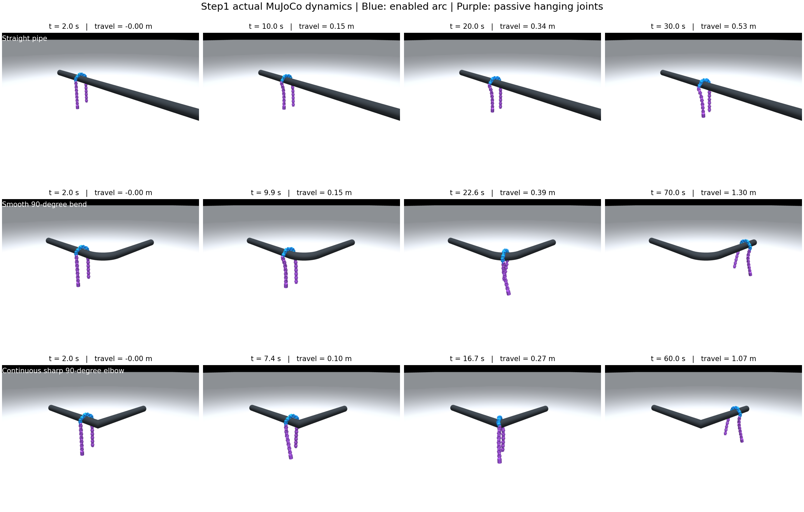
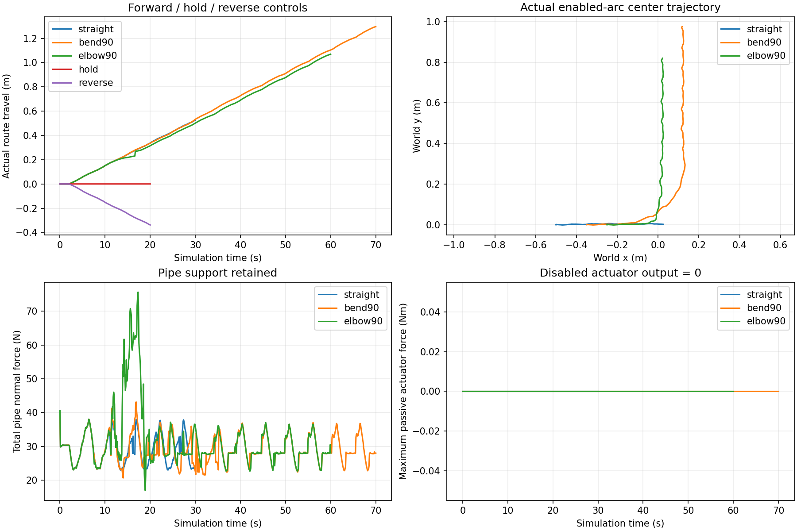

# Step1 动力学实验记录

本轮任务按用户澄清在仿真中完成设计与实验。以下均为重力、碰撞和电机驱动下的实际状态记录，不是目标构型动画；实机未执行。

## 条件

- Windows 11，Python 3.12.4，MuJoCo 3.3.0，NumPy 2.1.3。
- 20 关节，固定使能 J8–J13，其余关节主动执行器力矩为零；初始姿态仅设置一次。
- 幅值 60°、角频率 0.6 rad/s，2 s 静置后开始滚动；同一公式贯穿三类管道。
- 默认使用参考关节阻尼 1.5 N·m·s/rad、原摩擦参数和 2.355 N·m 力矩上限。
- 时间步 1 ms，实际状态/接触记录 10 Hz。使能窗口和步态不使用场景接触或进度反馈。

## 结果

| 试验 | 模拟时间 | 实际沿管进度增量 | 判定 |
| --- | ---: | ---: | --- |
| 直管正向滚动 | 30 s | +0.526 m | 通过 |
| 柔弯 90°，R=300 mm | 70 s | +1.296 m | 整体越过弯段，继续沿出口滚动 |
| 实体连续的 90° 急弯 | 60 s | +1.070 m | 整体越过急弯，继续沿出口滚动 |
| 直管保持相位 | 20 s | −0.000008 m | 基本静止 |
| 直管反向滚动 | 20 s | −0.338 m | 推进方向反转 |
| 柔弯，阻尼改为 0.05 | 70 s | +1.205 m | 通过 |
| 急弯，阻尼改为 0.05 | 60 s | +1.056 m | 通过 |

所有试验满足：窗口外主动力矩为零、主动力矩未超过上限、采样中没有地面支撑或失去管道支撑、关节在限位容差内、没有新增求解器警告。弯管还要求最终整条骨架均位于弯段出口后至少 50 mm，排除“仅前部通过”的情况。详细布尔检查和实际数值在 `summary.json` 及各试验 JSON 中。

三条实际轨迹展示了直线推进、柔弯转向和急弯转向。急弯的沿管进度采用最近中心线投影，转角附近可能发生管段投影切换；它不是三维中心轨迹的累计路程。

## 数据与重现

每个 `*_trace.npz` 包含实际完整根部/关节 `qpos`、`qvel`、骨架、目标、主动执行器力矩、使能掩码、管轴和配置；`metric_fields` 说明指标数组的列名。NPZ 中的目标是实际该步使用的名义控制参考，不应当作实测关节角。

在仓库根目录执行 `py -3.12 validation/step1_experiment.py` 重现完整实验；执行 `py -3.12 validation/render_step1.py` 从记录的实际状态生成截图。安装 `requirements-media.txt` 后加 `--video` 生成本机四倍速视频，保存在 `validation/results/videos/`。

## 限制与后续

当前是默认已知初始搭管构型、固定窗口和给定摩擦下的确定性验证；没有随机扰动、摩擦边界或任意初始构型下的通过率结论。急弯过程中力矩触及上限，实际角与目标角会产生明显误差，不能以目标构型宣称精确跟踪。

记录的正机械驱动功仅供后续计算参考，不等于电能；本轮未比较其他步态的能效。真实电机断电阻力、接触摩擦和闭环参数仍需后续辨识。滑动窗口与顺应性属于 Step2。
