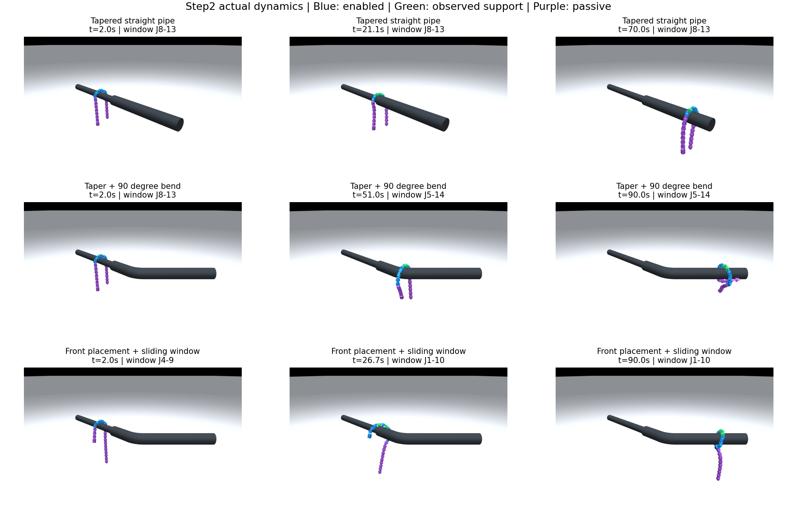
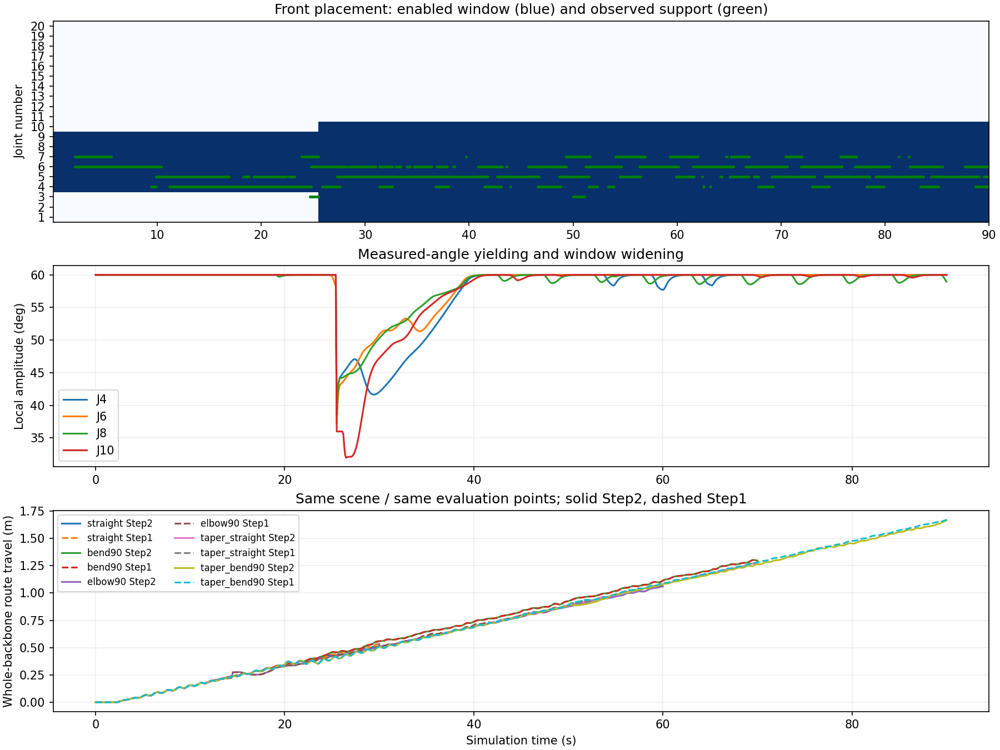

# Step2 动力学实验记录

2026-10-11，Windows / Python 3.12.4 / MuJoCo 3.3.0 / NumPy 2.1.3。10 个 Step2 案例及 5 个固定窗口 Step1 对照均通过。以下是每组参数一次确定性运行，没有据此计算普遍通过率。





| 案例 | 时长 | 骨架均值沿管增量 | 最小骨架最终进度 | 目标窗口最终范围 | 迁移次数 |
| --- | ---: | ---: | ---: | --- | ---: |
| 直管 | 30 s | 0.533489 m | 1.210617 m | J8–J13 | 0 |
| 柔弯 90° | 70 s | 1.296752 m | 2.083285 m | J8–J13 | 0 |
| 连续急弯 90° | 60 s | 1.060954 m | 1.857054 m | J8–J13 | 0 |
| 变径直管 | 70 s | 1.273609 m | 1.861686 m | J8–J13 | 0 |
| 变径弯管 | 90 s | 1.665059 m | 2.203341 m | J5–J14 | 1 |
| 前部 J4–J9，变径直管 | 70 s | 1.215213 m | 1.769176 m | J1–J10 | 1 |
| 前部 J4–J9，变径弯管 | 90 s | 1.598984 m | 2.150179 m | J1–J10 | 1 |
| 后部 J12–J17，变径弯管 | 90 s | 1.595875 m | 2.149341 m | J12–J17 | 0 |
| 滚动到相位 1.2 rad 后接入，变径弯管 | 90 s | 1.655617 m | 2.152675 m | J5–J14 | 1 |
| 已有前部姿态接管，改变悬垂尾段角度 | 65 s | 1.250826 m | 2.202994 m | J1–J8 | 0 |

最后一例从前部弯管 26.7 s 的实际状态开始，改变 J14–J20 悬垂角为 `[12,-18,22,-12,18,-8,10]°`，不导入旧使能或控制目标。一次性放置后，从真实支撑和当前角度接管，拟合相位约 1.518 rad，之后仅物理步进。初始姿态存于 `pose_initial_state.npz`。这是一例已有不对称姿态，不代表任意随机摆放都成立。

## 验收条件与观测

每个物理步检查窗口外有效电机力矩为零、主动电机力矩不超过 2.355 N·m、关节超限小于 0.02 rad、状态有限；确认没有新增求解器警告。100 ms 样本检查地面支撑小于 0.1 N、管道无支持连续区间短于 0.5 s。前进增量大于 0.3 m；含几何特征场景要求最小骨架进度越过特征出口至少 0.05 m。本轮地面支持、无支持最长区间和被动电机最大力矩均为零。接触峰值没有被解释为真实舵机可承受载荷。

变径直管特征结束 0.966583 m，变径弯管结束 1.552203 m；其余弯段位置在各 JSON 中。路线只用于这些评价，不进入控制器。时长包含通常 2 s 初始静置；相位切换例在 4 s 接入，最后一例直接接管已有姿态。

默认变径弯管在仿真约 49.68 s 从 J8–J13 变为 J5–J14；前部变径弯管约 25.44 s 从 J4–J9 变为 J1–J10。JSON 的 `window_events.time_s` 是**控制器接入后的时间**，应加 `takeover_s` 才是总仿真时间。有效驱动数本轮最多 10 个，剩余关节电机力矩为零；机械阻尼仍存在。局部幅值本轮最低约 31.99°，急弯最低约 50.68°。

变径直管幅值一直处于 60°上限、窗口未迁移，因此不能把该案例说成“靠顺应性扩大圆弧才通过”。弯管和前部放置实际发生了幅值调整、窗口迁移，图中可核对。

## 同场景基线对照

| 场景 | Step1 沿管增量 | Step2 沿管增量 | Step2 相对差异 |
| --- | ---: | ---: | ---: |
| 直管 | 0.533179 m | 0.533489 m | +0.058% |
| 柔弯 | 1.296171 m | 1.296752 m | +0.045% |
| 急弯 | 1.079981 m | 1.060954 m | -1.762% |
| 变径直管 | 1.274690 m | 1.273609 m | -0.085% |
| 变径弯管 | 1.671077 m | 1.665059 m | -0.360% |

这次 Step1 与 Step2 都用整条骨架均值评价，与历史 Step1 报告的固定使能段中心口径不同，不能混用两表数字。基线也通过了变径场景；本轮不证明通过率提升。变径弯管机械正功约 171.05→218.01 J，约增加 27.46%；不能宣称节能优势。正功是 `∫sum(max(torque*velocity,0))dt`，不计能量回收，不是电能。

## 复现与证据

仓库根目录运行：

```powershell
# 9 个常规/偏置案例，随后自动生成已有姿态接管案例
py -3.12 -X utf8 validation/step2_experiment.py
# 固定窗口同场景对照，保持与报告相同案例集
py -3.12 -X utf8 validation/step2_experiment.py --baseline --cases straight bend90 elbow90 taper_straight taper_bend90
# 从保存状态生成截图/指标图及本机回放视频
py -3.12 -X utf8 validation/render_step2.py --video
# 单独重跑姿态接管，使用输出目录中已保存的前部弯管轨迹
py -3.12 -X utf8 validation/step2_experiment.py --pose-takeover
```

`summary.json` 保存 10 个 Step2 案例；`baseline_summary.json` 保存 5 个对照。每个 JSON 包含具体检查、参数、机械正功和窗口事件；每个 NPZ 保存实际 qpos/qvel、骨架点、目标、逐关节主动力矩、有效掩码、支撑反力、幅值和窗口。渲染使用这些实际状态，回放不计作新试验。

本机视频 `validation/results/videos/step2_front_taper_bend90_4x.mp4` 为 4 倍速。视频不入 Git，原始状态与生成脚本已保存。完整方法、假设、硬件估计边界见 [设计说明](../../../docs/Step2设计说明.md)。
