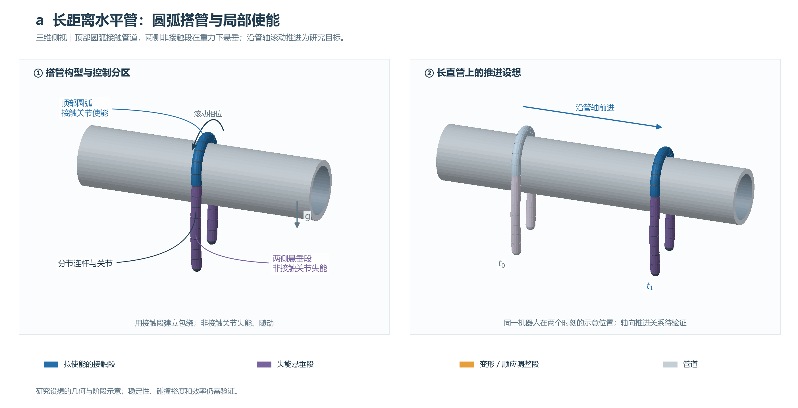
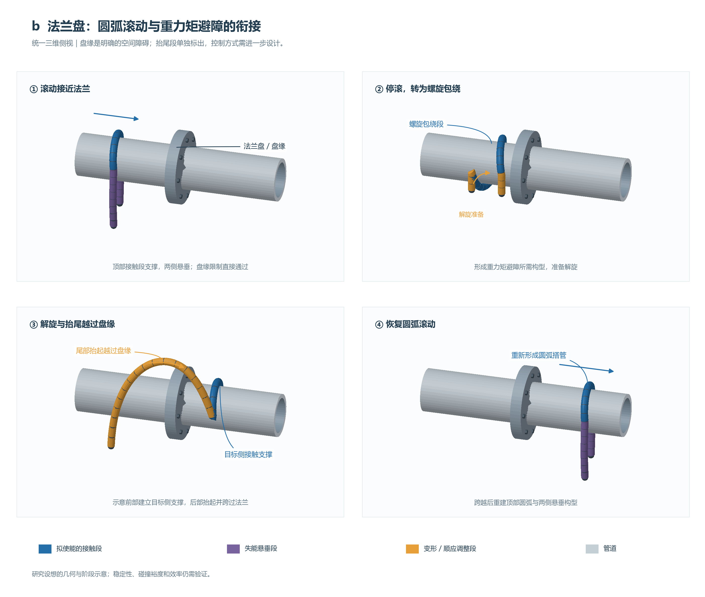
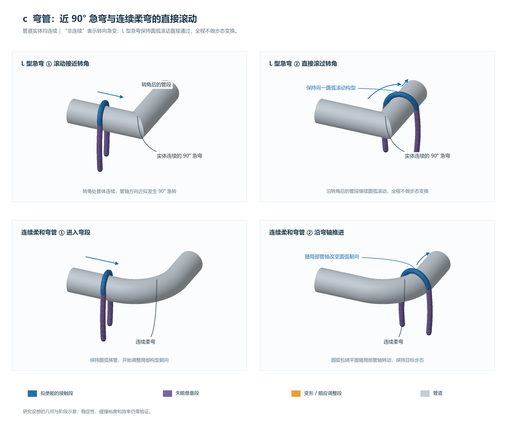
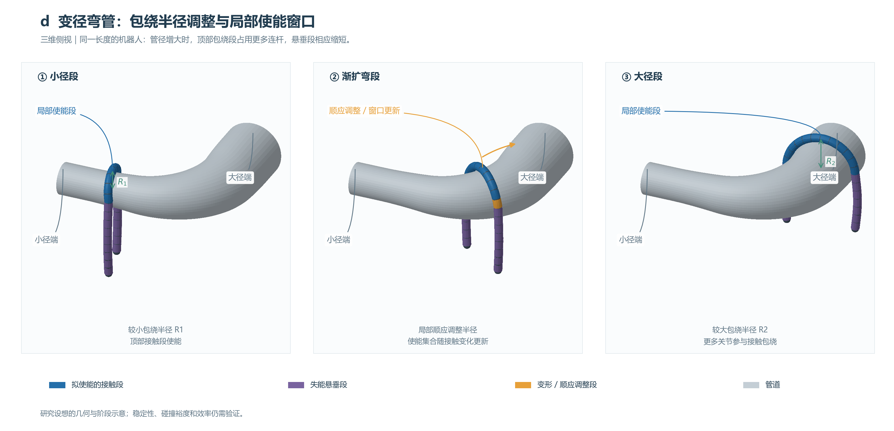
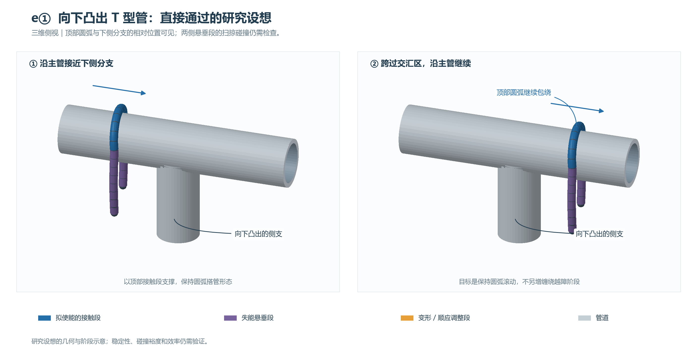
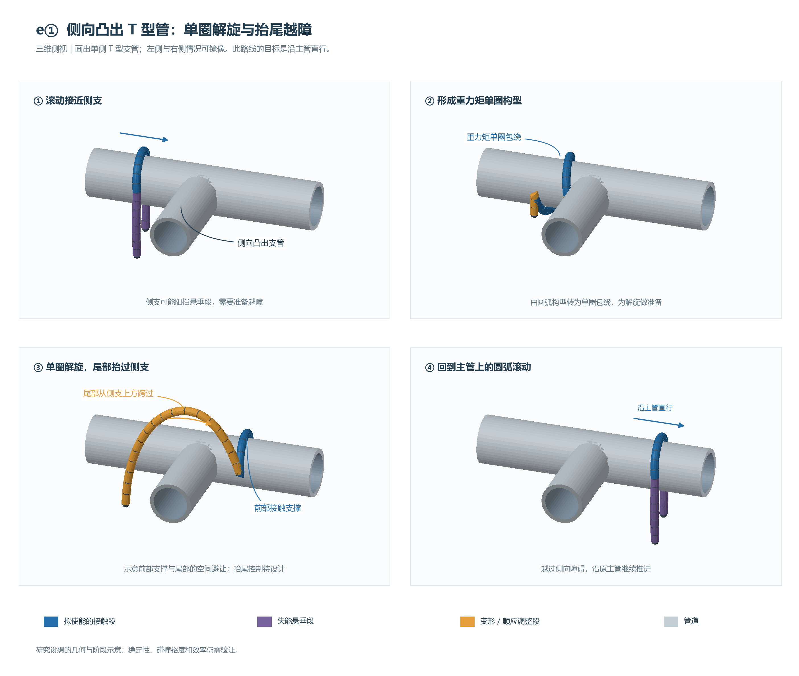
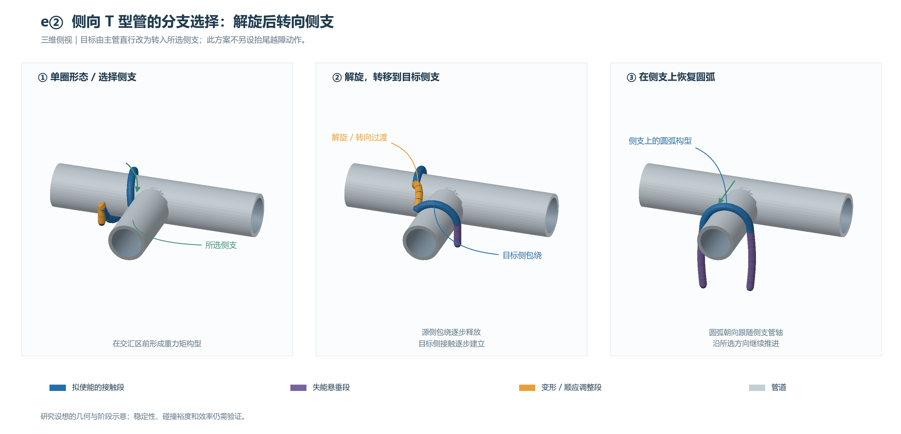

### 圆弧滚动运动（Rolling Helix-Arc）研究路线

#### 1. 简要描述

​	圆弧滚动运动主要借助及其简单的构型，实现高效率、低耗能的管道跨越避障运动。并能够与**重力矩避障方法、顺应性控制方法**结合，实现过**多种管道障碍**，包括L型急弯管、法兰盘、T型管、变径管，并且能够实现在T型管道上的分支选择。该运动特色为，**上管时只有与管道接触的部分使能，其余关节均失能**。

> **弯管术语说明：**本文所称“非连续 L 型管”是管道实体连续、转向非常急的弯管，可近似为 90° 直角。“非连续”指管轴方向变化不平滑的几何近似，并不表示管道存在断口或间隙。后文以“L 型急弯管”指代此场景。

#### 2. 主要解决问题

> **图示说明：**以下三维侧视图表达拟研究的构型和动作阶段，并非已验证的运动轨迹。蓝色为拟使能的接触段，紫色为失能悬垂段，橙色为变形或顺应调整段，灰色为管道。效率、能耗和通过率仍需比较实验验证。

​	**a. 在平面管道领域，相比于任何一个管道爬行方法，该方法能够更加节能且更加高效过较长无障碍的水平管（尤其对于螺旋管道而言）。**

​	*示意图 a｜三维侧视：以顶部圆弧接触管道，两侧非接触段失能并悬垂；右图用同一机器人在两个时刻的位置表达沿管轴推进的设想。具体滚动相位与轴向位移的关系需建模和验证。*

​	**b. 对于非连续水平直管道，比如水平管道上有法兰盘障碍。利用圆弧滚动运动+重力矩避障方法，能够实现高效率、稳定低成本过法兰盘障碍。**

​	*示意图 b｜法兰盘跨越的四阶段设想：滚动接近 → 停滚并形成螺旋包绕 → 解旋、建立目标侧支撑并抬尾越过盘缘 → 恢复圆弧滚动。橙色抬尾段表示需要设计的构型调整，不代表失能关节可以主动抬起。*

​	**c. 对于弯管道，包括管道实体连续、转向接近 90° 直角的 L 型急弯管，以及连续柔和弯管道，研究保持圆弧滚动直接通过、全程不做步态变换，以实现更高效率、更低能耗的弯管通过。**

​	*示意图 c｜抬高观察角度的三维侧视：上排是转角处实体连续、管轴方向近似发生 90° 急转的 L 型急弯管，展示保持圆弧滚动直接通过转角、沿转角后的管段继续前进的设想，全程不做步态变换；下排展示连续柔弯上，圆弧包绕平面随局部管轴转向。急弯通过时的接触变化、悬垂段碰撞与支撑稳定性仍需验证。*

​	**d. 变径弯管道跨越（异径弯管），利用顺应性控制的思想，使用圆弧滚动运动实现变径管道跨越+弯管道跨越（只在弯变径管上验证即可）。**此处的圆弧滚动运动+顺应性控制需要解决如何实现局部顺应性控制，需要圆弧既能保证不掉下管道，又能保证随管道半径扩大而放大（只有局部使能关节进行顺应性控制，其余关节失能）。

​	*示意图 d｜同一机器人沿渐扩弯管前进的三维侧视设想：小径段 → 渐扩弯段 → 大径段。包绕半径由 R1 增大到 R2，顶部包绕段占用更多连杆，悬垂段相应缩短；局部顺应控制随接触变化更新使能关节集合，橙色标出调整区域。*

​	**e. 对于T型管道，尤其T型向下凸出、T型向左右两侧凸出管道，本方法能够高效实现跨管避障与分支选择：**

​	**① 对于跨管避障。**向下凸出的T型管道，直接以圆弧滚动运动形态滚过去即可，相比于传统螺旋步态甚至更复杂的螺旋波步态，能实现更加高效率且低成本的障碍跨越；对于向两侧凸出的T型管道，只需将蛇形机器人形态拟合成重力矩避障的单圈形态，利用重力矩避障的思想，单圈解旋之后将尾部抬起越过凸起侧管道，即可实现凸起侧管道的障碍物跨越过程，最终形态回归圆弧滚动运动。

​	*示意图 e-1｜向下凸出的 T 型管：目标是在主管上保持圆弧搭管并通过交汇区；三维侧视显示顶部接触段、两侧悬垂段与下侧支管的位置关系。仍需检查悬垂段在运动中的扫掠碰撞。*

​	*示意图 e-2｜侧向凸出的 T 型管越障：接近侧支 → 形成重力矩单圈构型 → 解旋并抬尾从侧支上方跨过 → 恢复圆弧滚动，沿原主管直行。图中绘制单侧支管；向左与向右凸出的情况可镜像理解。*

​	**② 对于分支选择。**对于向两侧凸出的T型管道，拟合成重力矩的单圈形态，利用重力矩避障的思想，完成单圈解旋之后即可实现分支选择（相比于①的跨越T型管障碍，无需将尾部抬起即可实现分支选择），最终形态也回归圆弧滚动运动。

​	*示意图 e-3｜侧向 T 型管分支选择：单圈包绕 → 解旋、源侧包绕逐步释放并建立目标侧接触 → 在所选侧支上恢复圆弧构型。该路线转向侧支，不另设“抬尾后沿主管直行”的越障动作；支撑交接的具体实现仍需研究。*

#### 3. 难点分析

​	**a. 非连续法兰盘障碍跨越。**需要借助重力矩避障方法，先缠绕成螺旋，再利用重力矩解旋，实现法兰盘跨越。该方法主要依赖于重力矩方法，但是该方法具体稳定性与效率需要实测（需要多实机验证，目前从过程来想估计跨越稳定性可能无法保证）。

​	**b. 对于变径弯管道跨越。**需要提出一种能够实现局部使能而其余关节失能，使能局部能够根据管道半径变化而实时调整缠绕半径的方法。该方法的特性为，随着接触到管道的关节变多，使能的局部关节能够即时增多，以此来保证对于管道的稳定包绕，为一种类似滑动窗口的局部顺应性控制方法。

​	**c. 对于T型管道跨越（两侧凸出T型管道）。**需要先形成重力矩避障的单螺旋，此为一个问题，需要解决圆弧滚动步态如何上升缠绕成标准螺旋步态；基于此，还要能够实现左右两侧悬垂关节数不同时，如何实现自由调整悬垂在两侧的关节数量（比如钩挂的时候左边短右边长，如何让步态恢复到两侧均匀的圆弧形态）。除此之外，尾部如何抬起实现解旋也为一个需要解决的运动问题，可以使用重力矩现有的步态？还是说需要需要设计一种新步态？

​	**d. 对于水平管道法兰盘跨越。**要么还是结合重力矩避障的方法，但是需要解决在重力矩避障方法的基础下如何保证对法兰盘障碍的高通过率（目测出现打滑的概率会不小，可以在重力矩方法上研究尝试克服这一问题）；要么尝试提出一种新步态，能够实现法兰盘的高效跨越。

#### 4. 后续方案计划开展步骤

​	**整体规划：**

​	从直管实现开始，依次完成直管、弯管、直管顺应性、弯管顺应性、T型管道系列（跨越与分支选择）。先将关键步骤实现，再展开拓展实验验证。该**运动的关键步骤为局部滑动窗口顺应性控制**，其余关于重力矩避障的部分可在其他工作中借鉴。

​	**Step1. 编程实现圆弧滚动步态基础形态**，需要做到局部使能与其余关节失能，并在仿真与实机中完成直管、弯管跨管验证。

​	**Step2. 基于圆弧滚动步态基础形态，开发局部滑动窗口顺应性控制。**

> 开发记录（2026-10-11）：已完成仿真与实机代码移植，方法、支持观测限制及已测姿态范围见 [Step2设计说明](docs/Step2设计说明.md)，实际状态与基线对照见 [Step2实验记录](validation/reports/step2/README.md)。真实机器人跨管效果待后续实验验证；原计划内容保留如下。

​	**① 先完成局部顺应性控制的开发**，在Mujoco中验证。验收标准为对于弯管道、直管道的跨越与基本步态形态无异，并且能够实现直、弯变径管在仿真中的跨越。

​	**② 实机验证**，完成直变径管道的跨越（弯变径管如果到货了也可以进行验证尝试）。

​	**③** **滑动窗口方法开发**，实现能够对收管道力支持力的关节使能，而对于其余关节保持失能，并且能够实现任意位置的局部顺应性控制，而非仅仅正中间段能顺应性控制。验收标准为允许以任意姿态搭载Mujoco仿真的管道上，切换到顺应性控制模式时，与管道实际接触的部分关节都能够使能并运用顺应性控制方法，而其余关节均失能，并且能够实现变径直管、弯管的正常跨越。
​	**④ 实机验证**，完成任意位置摆放，切换到顺应性控制模式后能实现变径直管、弯管的正常跨越。并**与已有水平管道运动方法做比较**，记录实验数据，验证我们的高效率与低成本优势。

​	**Step3. 编程实现T型管道跨越，重点在于螺旋与圆弧滚动的运动切换实现。**（Mujoco只用于构型验证，所有的实验都在实机场景中开展与验证）

​	**①** 运动切换后利用**重力矩方法解旋实现T型两侧凸出跨越**。过程中可能会需要用到滑动窗口局部顺应性控制？毕竟解旋之后不一定关节还是均匀分布在管道两侧？

​	**②** 跨越管道后编程实现**尾部段抬起跨越凸起分支**。

​	**③** 如果跨越后**蛇形机器人在管道两侧分布不均，考虑加入均匀分布恢复步态**（先验证不对称悬垂是否影响支撑稳定、滚动推进和障碍净空，不然可以不必要加入多余恢复步态）

​	④ **实机验证完整流程**，圆弧滚动 - 单圈构型 - 解旋与前部通过交汇区 - 尾部越过侧支-恢复圆弧滚动。（起步阶段是否考虑加入任意姿态摆放后都能实现局部使能的顺应性？）

​	**Step4. 基与T型管跨越运动过程，在实机中尝试能否直接实现分支选择。**实机验证，与改进，不在Mujoco中浪费时间。

​	**Step5. 实现水平管道跨越法兰盘。**借鉴重力矩控制方法实现，在实机中验证与改进。

